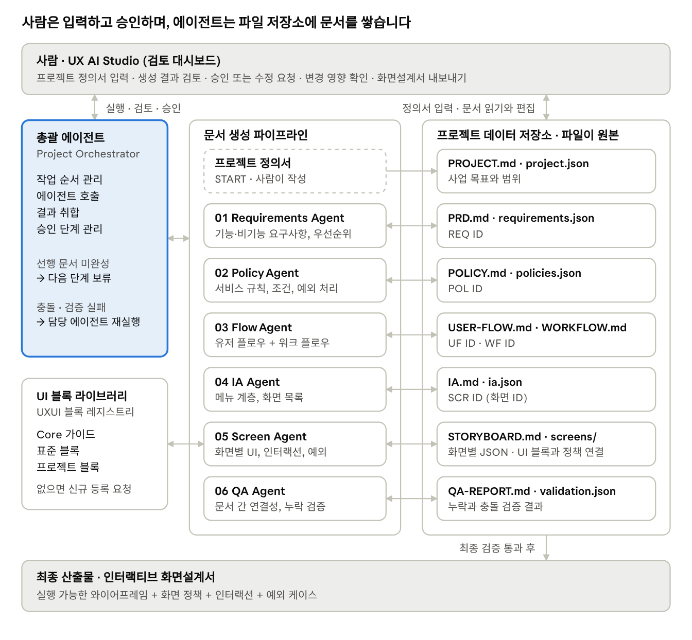

# 프로젝트 정의서: AI UX 설계 자동화 시스템

## 1. 프로젝트 개요

이 프로젝트는 사람이 쓴 프로젝트 정의서를 입력으로 받아, AI 에이전트가 요구사항 정의서부터 화면설계서까지 기획 문서를 차례로 만들고 검증하는 통합 UX 설계 시스템을 만듭니다.

최종 산출물은 인터랙티브 화면설계서입니다. 실행 가능한 와이어프레임에 화면 정책, 인터랙션, 예외 케이스를 함께 담습니다.

배경은 두 가지입니다.

- PRD를 그대로 AI에 넘겨 화면을 그리게 하면 결과의 일관성이 떨어집니다. 문서 분석, 화면 분리, UI 매핑, 정책 연결 같은 중간 단계가 필요합니다.
- 문서가 늘어나면 정책 하나가 바뀔 때 어느 플로우와 화면을 고쳐야 하는지 찾기 어렵습니다. 문서마다 ID와 참조 관계를 두어야 영향 범위를 자동으로 찾을 수 있습니다.

## 2. 목적과 성공 기준

목적은 기획 문서에서 화면설계서까지를 하나의 추적 가능한 흐름으로 잇는 것입니다. 화면을 얼마나 보기 좋게 그리는지는 성공 기준이 아닙니다.

성공 기준은 세 가지입니다.

- **정확한 해석**: 기획자가 쓴 요구사항과 정책을 정확하게 해석합니다.
- **일관된 재사용**: 이미 정의된 UI 블록을 일관되게 재사용합니다.
- **누락 없는 변환**: 요구사항과 정책을 빠짐없이 화면설계서로 옮깁니다.

이를 위해 시스템은 문서 사이의 세 가지 관계를 관리합니다.

| 관계 | 답하는 질문 |
| --- | --- |
| 생성 관계 | 어떤 문서를 바탕으로 다음 문서를 만드는가 |
| 참조 관계 | 각 문서가 다른 문서의 어떤 정보를 참조하는가 |
| 변경 영향 | 앞 문서가 바뀌면 뒤 문서의 어디를 고쳐야 하는가 |

## 3. 핵심 사용자

주 사용자는 기획자입니다. 기획자는 터미널이 아니라 검토 대시보드(UX AI Studio)에서 에이전트와 산출물을 다룹니다.

| 사용자 | 이 시스템으로 하는 일 |
| --- | --- |
| 기획자 | 프로젝트 정의서 작성과 입력, 에이전트 실행, 생성 문서 검토·수정·승인, 변경 영향 확인, 화면설계서 내보내기 |
| UI 블록 담당자 (디자이너, 디자인시스템 관리자) | UI 블록 등록과 버전 관리, 화면 생성 중 들어온 신규 블록 등록 요청 처리 |
| 개발·QA 담당자 | 승인된 화면설계서를 넘겨받아 개발과 테스트에 사용 |

문서별 승인 권한을 누가 갖는지는 아직 정하지 않았습니다.

## 4. 프로젝트 범위

범위는 프로젝트 정의서를 입력받은 뒤부터 화면설계서를 검증해 승인하기까지입니다.

### 포함

| 항목 | 내용 |
| --- | --- |
| 문서 생성 파이프라인 | 요구사항 정의서, 정책서, 유저 플로우, 워크 플로우, 정보 구조도, 화면설계서, 검증 결과 |
| 에이전트 | 총괄 에이전트 1개와 전문 에이전트 6개 (Requirements, Policy, Flow, IA, Screen, QA) |
| 프로젝트 데이터 저장소 | Markdown·JSON 파일, 문서 ID, 문서 간 참조 관계 |
| UI 블록 라이브러리 연결 | 이미 기획한 UXUI 블록 레지스트리의 블록을 검색해 화면에 재사용하고, 없는 블록은 신규 등록을 요청 |
| 검토 대시보드 | 생성 결과 확인, 수정 요청, 승인, 참조 관계와 변경 영향 확인 |
| 변경 추적과 검증 | 바뀐 문서를 참조하는 산출물 탐색, 영향받는 부분만 재생성, 전체 문서 정합성 검증 |

### 제외

| 항목 | 처리 |
| --- | --- |
| Business Agent | 범위 밖입니다. 프로젝트 정의서는 AI가 만들지 않고 사람이 작성해 입력합니다. |
| ERD (데이터 구조 정의서) | 이번 범위에서 빼고 추후 고도화 방안으로 남깁니다. |

## 5. 시스템 아키텍처

총괄 에이전트가 전문 에이전트 6개를 순서대로 호출하고, 각 에이전트는 공통 저장소의 파일을 읽고 씁니다. 사람은 대시보드에서 정의서를 넣고 단계마다 승인하며, UI 블록 라이브러리는 Screen Agent가 화면을 조합할 때 사용합니다. 에이전트는 Claude Code와 MCP로 구성한 워크스페이스에서 실행합니다.

## 6. 문서 생성 파이프라인과 에이전트

사람이 쓴 프로젝트 정의서에서 시작해 전문 에이전트 6개가 순서대로 문서를 만듭니다. 각 문서는 앞 문서를 복사하지 않고 참조하며, 그 위에 새로운 결정을 더합니다.

| 단계 | 담당 | 산출물 (생성 ID) | 전달받는 것 | 새로 정의하는 것 |
| --- | --- | --- | --- | --- |
| START | 사람 | 프로젝트 정의서 | 최초 사업 정보 | 사업 목표와 범위 |
| 01 | Requirements Agent | 요구사항 정의서 (REQ) | 프로젝트 목표 | 기능·비기능 요구사항, 사용자 유형, 우선순위, 수용 기준 |
| 02 | Policy Agent | 정책서 (POL) | 요구사항 | 서비스·운영 정책, 권한, 조건, 상태값, 예외 처리 |
| 03-A | Flow Agent | 유저 플로우 (UF) | 요구사항, 정책 | 사용자 행동, 진입 경로, 분기, 완료, 이탈 |
| 03-B | Flow Agent | 워크 플로우 (WF) | 요구사항, 정책 | 시스템 처리, 데이터 흐름, 검증, 상태 변경, 연동 |
| 04 | IA Agent | 정보 구조도 (SCR) | 플로우, 기능 목록 | 메뉴 계층, 기능 그룹, 화면 목록, 화면 간 이동 관계 |
| 05 | Screen Agent | 화면설계서 | 모든 선행 문서, UI 블록 | 와이어프레임, UI 구성, 인터랙션, 화면별 디스크립션, 예외 상황 |
| 06 | QA Agent | 검증 결과 | 전체 문서 | 요구사항 반영률, 정책 일치성, 플로우 연결성, 화면 누락 판정 |

유저 플로우와 워크 플로우는 한쪽을 끝내고 다른 쪽을 쓰지 않고 서로 참조하며 함께 정의합니다. 에이전트 이름은 전체 스토리보드 캡처의 표기를 따랐습니다.

총괄 에이전트는 문서를 직접 쓰지 않습니다. 작업을 나눠 주고 문서 간 연결을 관리하며, 아래 규칙으로 움직입니다.

| 상황 | 총괄 에이전트의 처리 |
| --- | --- |
| 선행 문서 미완성 | 다음 에이전트 실행 보류 |
| 필수 정보 부족 | 이전 에이전트에 보완 요청 |
| 정책과 플로우 충돌 | Policy Agent와 Flow Agent 재실행 |
| 화면 누락 발견 | IA Agent에 수정 요청 |
| UI 블록 미존재 | 라이브러리 검색 또는 신규 블록 등록 요청 |
| 최종 검증 실패 | 해당 문서의 담당 에이전트에 수정 요청 |
| 최종 검증 통과 | 프로젝트 승인 상태 변경 |

## 7. 데이터 규격

Markdown과 JSON 파일이 원본이고, 대시보드 화면은 이 파일을 읽고 편집하는 뷰어입니다. 단계마다 사람이 읽는 문서와 시스템이 처리하는 데이터를 짝으로 만듭니다.

| 단계 | 사람이 읽는 문서 | 시스템 처리용 데이터 |
| --- | --- | --- |
| 프로젝트 정의 | PROJECT.md | project.json |
| 요구사항 | PRD.md | requirements.json |
| 정책 | POLICY.md | policies.json |
| 유저 플로우 | USER-FLOW.md | user-flow.json |
| 워크 플로우 | WORKFLOW.md | workflow.json |
| 정보 구조도 | IA.md | ia.json |
| 화면설계서 | STORYBOARD.md | screens/\*.json |
| 검증 결과 | QA-REPORT.md | validation.json |

모든 항목에는 고유 ID를 붙이고, 하위 문서가 상위 문서의 ID를 참조합니다.

| ID 접두어 | 대상 | 만드는 단계 | 예시 |
| --- | --- | --- | --- |
| REQ | 요구사항 | 01 Requirements | REQ-001 쿠폰 선택 기능 |
| POL | 정책 | 02 Policy | POL-001 최소 주문 금액 충족 조건 |
| UF | 유저 플로우 | 03-A Flow | UF-001 쿠폰 선택 프로세스 |
| WF | 워크 플로우 | 03-B Flow | WF-001 쿠폰 유효성 검증 |
| SCR | 화면 | 04 IA | SCR-001 주문/결제 화면 |

추적은 REQ → POL → UF·WF → SCR → UI 블록 순으로 이어집니다. 화면과 UI 블록, 정책의 연결은 블록 파일이 아니라 화면설계서 데이터(screens/\*.json)에 기록합니다. 블록은 여러 화면에서 재사용되기 때문입니다.

화면과 플로우의 구현 방식은 2026-11-25에 다음과 같이 정했습니다.

- **와이어프레임**: 화면설계서 JSON을 React로 렌더링하고, 인터랙션은 React State로 구현합니다.
- **유저 플로우**: JSON이 원본이며 React로 그리고 PNG로 내보냅니다.
- **내보내기**: 화면설계서는 Figma 또는 PPTX로 내보냅니다.
- **Figma 연결**: 처음부터 Figma 파일을 직접 만들지 않고, 검증된 화면을 나중에 Figma 디자인으로 연결합니다.

## 8. 승인과 변경 관리 원칙

AI가 만든 문서와 사람이 승인한 문서는 상태를 구분합니다. 승인 전에도 다음 단계 초안은 만들 수 있지만, 승인되지 않은 내용을 확정된 기획 정보로 취급하지 않습니다.

| 승인 지점 | 사람이 확정하는 것 |
| --- | --- |
| 프로젝트 정의서 | 사업 목표와 범위 |
| 요구사항 정의서, 정책서 | 기능과 서비스 규칙 |
| 플로우, 정보 구조도 | 서비스 프로세스와 화면 구조 |
| 화면설계서 | UI와 인터랙션 최종 |

문서가 바뀌면 그 문서만 고치지 않고 다음 순서로 처리합니다.

1. 바뀐 항목의 ID를 참조하는 산출물을 찾습니다.
2. 산출물마다 수정이 필요한지, 검토만 필요한지 판정합니다.
3. 바뀐 부분만 다시 생성하고 검증합니다.
4. 관련 산출물의 승인 상태를 다시 검토합니다.

예를 들어 POL-002(쿠폰 최대 사용 개수)가 1개에서 2개로 바뀌면, 유저 플로우·워크 플로우·정보 구조도·화면설계서는 수정 대상이 됩니다. 상위 문서인 요구사항 정의서는 정합성 재검토 대상이 됩니다.

## 9. 개발 단계와 우선순위

입력과 데이터 규격을 먼저 고정하고, 화면 생성과 변경 추적은 그 위에 올립니다. 일정은 아직 정하지 않았습니다.

| 순서 | 개발 항목 | 목표 |
| --- | --- | --- |
| 1 | 프로젝트 정의서 템플릿 | 사람이 쓰는 최초 입력을 표준화 |
| 2 | 에이전트 명세 (전문 6개, 총괄 1개) | 역할과 처리 규칙 정의 |
| 3 | 문서 데이터 규격 | JSON 스키마와 ID 체계 |
| 4 | 에이전트 오케스트레이터 | 실행 순서와 상호작용 관리 |
| 5 | 문서 검토 대시보드 | 생성 결과 승인과 수정 |
| 6 | UI 블록 라이브러리 연결 | Figma 컴포넌트 재사용 |
| 7 | 화면설계서 생성 엔진 | 인터랙티브 화면 생성 |
| 8 | 변경 추적과 QA | 전체 문서 정합성 유지 |

이 정의서 다음에 쓸 문서는 「AI UX 설계 자동화 시스템 기능 정의서」입니다. 위 파이프라인을 실제 기능, 화면, 데이터, 에이전트 실행 규칙으로 옮깁니다.

## 10. 추후 고도화 방안

ERD(데이터 구조 정의서)는 이번 범위에서 빼고 고도화 단계에서 추가합니다.

- **필요한 경우**: 주문, 결제, 쿠폰, 회원처럼 여러 데이터가 연결되는 서비스입니다.
- **들어갈 자리**: 요구사항 정의 다음이며, 정책서·워크 플로우와 함께 작성합니다.
- **그때까지의 처리**: 상태값과 조건은 정책서에, 데이터 흐름과 상태 변경은 워크 플로우에 적습니다.

## 11. 미정 사항

착수 전에 정해야 할 것들입니다.

- [ ] 파일럿으로 검증할 서비스와 화면 (참고 자료의 예시는 배달앱 주문/결제 화면)
- [ ] 기준 Figma 파일과 실제 UI 블록 (블록 레지스트리 프로토타입은 목업 데이터)
- [ ] UI 블록 ID와 화면 안 영역 ID의 체계 (자료마다 UI-001, BLK-0001, UI-ORDER-001로 다름)
- [ ] 문서 승인 상태의 값과 문서별 승인 권한자
- [ ] Flow Agent 하나가 유저 플로우와 워크 플로우를 함께 만드는지 여부
- [ ] 웹에서 에이전트를 구동할 방식. API 과금 방식은 제외했고, [기능 정의서](03-functional-spec.md) 7절이 Claude Code 웹과 GitHub 저장소 방식을 검토했습니다.
- [ ] 개발 일정과 정량 목표

## 변경 이력

| 버전 | 날짜 | 변경 내용 |
| --- | --- | --- |
| 0.1.0 | 2026-11-24 | 최초 작성. ERD는 추후 고도화, Business Agent는 범위 밖으로 정함 |
| 0.2.0 | 2026-11-25 | 렌더링(React), 인터랙션(React State), 내보내기(Figma 또는 PPTX), 유저 플로우(JSON 원본) 결정 반영 |
| 0.2.1 | 2026-11-25 | 미정 사항의 웹 구동 방식 문구 수정. Git 저장소로 이관 |
