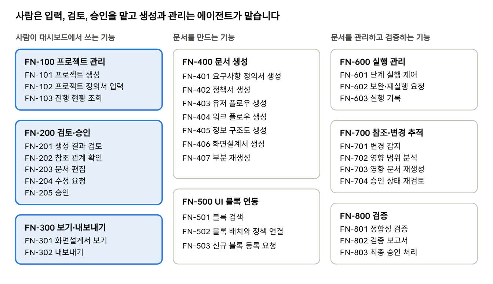
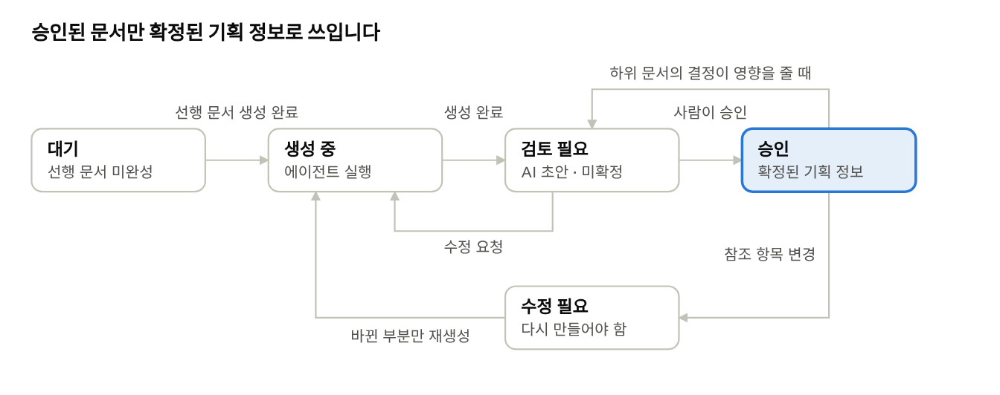
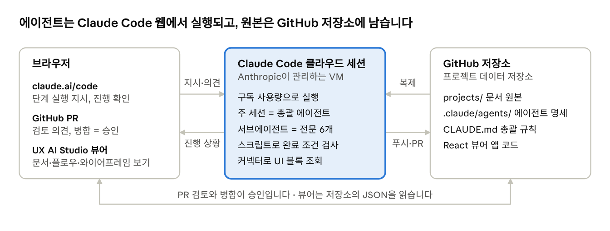

# 기능 정의서: AI UX 설계 자동화 시스템

## 1. 문서 개요

이 문서는 [프로젝트 정의서](00-project-definition.md)의 파이프라인을 실제 기능, 화면, 데이터, 에이전트 실행 규칙으로 옮긴 것입니다. 개발에 들어가기 전에 무엇을 만들지 합의하는 기준이 됩니다.

| 항목 | 내용 |
| --- | --- |
| 기준 문서 | 프로젝트 정의서 (2026-11-24) |
| 범위 | 프로젝트 정의서 입력부터 화면설계서 검증·승인까지 |
| 범위 밖 | Business Agent(정의서 자동 생성), ERD(추후 고도화) |
| 구성 요소 | 총괄 에이전트 1개, 전문 에이전트 6개, 프로젝트 데이터 저장소(GitHub), UI 블록 라이브러리, 뷰어(UX AI Studio) |

표기 규칙은 다음과 같습니다.

| 표기 | 뜻 |
| --- | --- |
| FN-000 | 이 시스템의 기능 ID |
| STU-00 | UX AI Studio(대시보드)의 화면 ID |
| REQ, POL, UF, WF, SCR | 파이프라인이 만드는 기획 문서 항목의 ID. SCR은 설계 대상 서비스의 화면이며 STU와 다릅니다. |
| WU-000 | 화면설계서를 작성하는 작업 단위의 ID. 정보 구조도에서 화면(SCR)을 묶어 정의합니다. |

참고 자료에 없어 이 문서에서 새로 정한 내용은 10절에 제안으로 모았습니다. 확정 전에 검토가 필요합니다.

## 2. 기능 구조

기능은 8개 그룹으로 나뉘고, 사람이 직접 쓰는 것은 그중 3개 그룹입니다.

파란 그룹은 사람이 직접 쓰는 기능이고, 나머지는 에이전트와 시스템이 수행합니다. 각 기능의 설명은 3절에 있습니다.

그림은 웹 구동 방식을 확정하기 전에 그린 것이라 사람이 쓰는 기능이 모두 대시보드 한 곳에 있습니다. 지금은 세션, GitHub, 뷰어 세 곳으로 나뉘며 3절의 실행 위치 열이 기준입니다.

## 3. 기능 목록

기능은 8개 그룹 32개입니다. 2절의 구조도는 0.4.1 기준이라 FN-206과 FN-408이 빠져 있습니다. 개발 순서는 프로젝트 정의서 9절의 단계 번호(1~8)입니다. 데이터 규격(3단계)은 모든 기능의 전제라 표에서 생략했습니다.

2026-11-25에 웹 구동 방식을 확정해(7절) 기능마다 실행 위치를 적었습니다. 세 곳의 역할은 다음과 같습니다.

| 실행 위치 | 무엇인가 | 하는 일 |
| --- | --- | --- |
| 세션 | claude.ai/code의 클라우드 세션 | 단계 실행 지시, 문서 생성, 수정 요청, 검증 실행 |
| GitHub | 프로젝트 데이터 저장소 | 정의서 작성, 문서 편집, PR 검토와 병합(승인), 변경 이력 |
| 뷰어 | UX AI Studio (React) | 진행 현황, 문서, 참조 관계, 플로우, 화면설계서, 검증 결과 보기 |

뷰어는 저장소의 파일을 읽기만 합니다. 편집, 승인, 실행은 뷰어 안에서 하지 않고 세션이나 GitHub으로 넘깁니다(POL-034).

### 사람이 쓰는 기능

| ID | 기능 | 설명 | 실행 위치 | 개발 순서 |
| --- | --- | --- | --- | --- |
| FN-101 | 프로젝트 생성 | 세션에 프로젝트 이름과 설명을 주면 저장소에 프로젝트 폴더와 기본 파일을 만들고 PR을 엽니다. | 세션 | 5 |
| FN-102 | 프로젝트 정의서 입력 | 저장소의 템플릿으로 정의서를 쓰거나 이미 쓴 PROJECT.md를 올립니다. 필수 항목 검사는 검증 스크립트가 하고, PR 병합이 확정입니다. | GitHub | 1, 5 |
| FN-103 | 진행 현황 조회 | 단계별 상태와 요약 수치(완료 단계, 검토 단계, 생성 문서)를 보여줍니다. | 뷰어 | 5 |
| FN-201 | 생성 결과 검토 | AI가 만든 문서와 생성 요약(근거 건수, 발견된 문제)을 보여주고, 플로우는 JSON을 React로 그린 다이어그램으로 미리 봅니다. 줄 단위로 무엇이 바뀌었는지는 PR의 변경 내역에서 봅니다. | 뷰어, GitHub | 5 |
| FN-202 | 참조 관계 확인 | 항목 ID를 고르면 그 항목이 참조하는 상위 항목과 그 항목을 참조하는 하위 항목을 보여줍니다. | 뷰어 | 5 |
| FN-203 | 문서 편집 | 사람이 PR 브랜치에서 문서를 직접 고칩니다. 수정은 원본 파일에 반영되고 커밋으로 기록됩니다. | GitHub | 5 |
| FN-204 | 수정 요청 | 세션에 의견을 말하거나 PR에 줄 단위 의견을 남겨 담당 에이전트에 재생성을 요청합니다. | 세션, GitHub | 5 |
| FN-205 | 승인 | PR을 병합해 문서를 승인 상태로 바꿉니다. 승인된 문서만 다음 단계의 확정 입력이 됩니다. 누가 병합할 수 있는지는 브랜치 보호 규칙으로 정합니다. | GitHub | 5 |
| FN-206 | 작업 단위 선택 | 승인된 정보 구조도의 작업 단위 목록과 상태를 보고, 어느 작업 단위의 화면설계서를 작성할지 세션에서 고릅니다. 하나 이상 고를 수 있습니다. | 세션, 뷰어 | 7 |
| FN-301 | 화면설계서 보기 | 왼쪽에 동작하는 화면, 오른쪽에 그 화면의 정책·디스크립션·예외 케이스를 보여줍니다. 화면은 화면설계서 JSON을 React로 렌더링하고, 인터랙션은 React State로 동작합니다. | 뷰어 | 7 |
| FN-302 | 내보내기 | 승인된 화면설계서를 Figma 또는 PPTX로, 유저 플로우를 PNG로 내보냅니다. PNG와 PPTX는 뷰어에서 만들고, Figma 연결은 화면을 검증한 뒤 세션의 커넥터로 합니다. | 뷰어, 세션 | 7 |

### 문서를 만드는 기능

문서를 만드는 기능은 모두 세션에서 전문 에이전트(서브에이전트)가 수행합니다.

| ID | 기능 | 설명 | 실행 위치 | 개발 순서 |
| --- | --- | --- | --- | --- |
| FN-401 | 요구사항 정의서 생성 | Requirements Agent가 프로젝트 정의서를 읽고 PRD와 REQ 항목을 만듭니다. | 세션 | 2, 4 |
| FN-402 | 정책서 생성 | Policy Agent가 요구사항별 서비스 규칙과 POL 항목을 만듭니다. | 세션 | 2, 4 |
| FN-403 | 유저 플로우 생성 | Flow Agent가 사용자 행동과 분기를 UF 항목으로 만듭니다. 원본은 JSON입니다. | 세션 | 2, 4 |
| FN-404 | 워크 플로우 생성 | Flow Agent가 시스템 처리와 상태 변경을 WF 항목으로 만듭니다. | 세션 | 2, 4 |
| FN-405 | 정보 구조도 생성 | IA Agent가 메뉴 계층과 화면 목록을 만들고 SCR ID를 붙입니다. | 세션 | 2, 4 |
| FN-406 | 화면설계서 생성 | Screen Agent가 선택된 작업 단위의 화면마다 UI 블록을 배치하고 인터랙션·디스크립션·예외 상황을 적습니다. 결과는 화면설계서 JSON이며 Figma 파일을 직접 만들지 않습니다. | 세션 | 7 |
| FN-407 | 부분 재생성 | 수정 요청이나 변경 영향으로 지정된 항목만 다시 만듭니다. 나머지 항목과 ID는 그대로 둡니다. | 세션 | 8 |
| FN-408 | 작업 단위 정의 | IA Agent가 정보 구조도를 만들 때 화면을 작업 단위(WU)로 묶어 제안합니다. 사람이 정보 구조도를 승인하면 작업 단위가 화면설계서 작성의 선택지가 됩니다. | 세션 | 2, 4 |
| FN-501 | 블록 검색 | UI 블록 라이브러리에서 Core 가이드, 표준 블록 순으로 맞는 블록을 찾습니다. 블록의 "쓰는 상황"과 "쓰지 않을 때"를 근거로 고릅니다. 라이브러리는 claude.ai 계정에 연결한 커넥터로 읽습니다. | 세션 | 6 |
| FN-502 | 블록 배치와 정책 연결 | 화면 영역마다 사용한 블록, 관련 요구사항, 정책을 화면설계서 데이터에 기록합니다. | 세션 | 6 |
| FN-503 | 신규 블록 등록 요청 | 맞는 블록이 없으면 프로젝트 블록으로 만들고 라이브러리에 등록 요청을 남깁니다. | 세션 | 6 |

### 문서를 관리하고 검증하는 기능

총괄 에이전트의 일은 주 세션이 CLAUDE.md의 규칙을 따라 수행하고, 시작·완료 조건 검사와 영향 분석은 저장소의 스크립트로 둡니다. 기록은 저장소 파일과 커밋 이력에 남습니다.

| ID | 기능 | 설명 | 실행 위치 | 개발 순서 |
| --- | --- | --- | --- | --- |
| FN-601 | 단계 실행 제어 | 총괄 에이전트가 시작 조건을 확인하고 에이전트를 호출합니다. 선행 문서가 미완성이면 보류합니다. | 세션 | 4 |
| FN-602 | 보완·재실행 요청 | 필수 정보가 부족하거나 문서끼리 충돌하면 담당 에이전트를 다시 실행합니다. | 세션 | 4 |
| FN-603 | 실행 기록 | 어느 에이전트가 언제 무엇을 읽고 만들었는지 runs.json에 남기고, 파일 변경은 커밋 이력으로 남습니다. | 세션, GitHub | 4 |
| FN-701 | 변경 감지 | 승인된 항목이 바뀌면 변경으로 기록합니다. 사람의 직접 편집도 포함하며, 커밋 비교로 찾습니다. | 세션, GitHub | 8 |
| FN-702 | 영향 범위 분석 | 바뀐 항목의 ID를 참조하는 산출물을 찾아 수정 필요 또는 검토 필요로 판정합니다. | 세션 | 8 |
| FN-703 | 영향 문서 재생성 | 수정 필요로 판정된 항목에 부분 재생성(FN-407)을 실행합니다. | 세션 | 8 |
| FN-704 | 승인 상태 재검토 | 영향받은 문서의 승인을 풀고 다시 검토를 받게 합니다. | 세션 | 8 |
| FN-801 | 정합성 검증 | QA Agent가 전체 문서를 9절의 규칙으로 검사합니다. | 세션 | 8 |
| FN-802 | 검증 보고서 | 검사 결과를 QA-REPORT.md와 validation.json으로 남기고, 실패 항목을 담당 에이전트에 넘깁니다. | 세션 | 8 |
| FN-803 | 최종 승인 처리 | 검증을 통과하고 사람이 화면설계서 PR을 병합하면 프로젝트를 승인 상태로 바꿉니다. | 세션, GitHub | 8 |

## 4. 화면 정의

웹 구동 방식 확정(7절)에 따라 사람이 쓰는 화면이 세 곳으로 나뉩니다. 전에는 UX AI Studio 한 곳에 화면 8개를 두었으나, 맞춤 화면 안에서 에이전트를 실행하거나 저장소에 되쓸 수 없으므로 다음과 같이 나눴습니다.

| 곳 | 사람이 하는 일 | 연결 기능 |
| --- | --- | --- |
| claude.ai/code 세션 | 프로젝트 만들기, 단계 실행 지시, 대화하며 수정 요청, 재생성과 검증 실행 | FN-101, FN-204, FN-4xx, FN-5xx, FN-6xx, FN-7xx, FN-8xx |
| GitHub | 프로젝트 정의서 작성, 문서 편집, PR 변경 내역 검토, 줄 단위 의견, 병합(승인) | FN-102, FN-201, FN-203, FN-204, FN-205 |
| 뷰어 (UX AI Studio) | 진행 현황, 문서와 참조 관계, 플로우, 화면설계서, 검증 결과 보기와 내보내기 | FN-103, FN-201, FN-202, FN-301, FN-302, FN-702 |

### 4.1 뷰어 화면

뷰어는 저장소의 파일을 읽어 보여 줍니다. 저장소에 쓰지 않으므로 모든 화면이 읽기 전용이고, 편집·승인·실행이 필요한 자리에는 세션이나 GitHub으로 가는 링크를 둡니다.

| 화면 ID | 화면 | 주요 구성 | 나가는 링크 | 연결 기능 |
| --- | --- | --- | --- | --- |
| STU-01 | 프로젝트 목록 | 프로젝트 카드(이름, 진행 상태) | 새 프로젝트는 세션으로 | FN-101 |
| STU-02 | 프로젝트 대시보드 | 요약 수치 3개, 기획 진행 단계 7개와 상태, 현재 단계 카드(AI 생성 결과 요약, 미리보기, 참조 문서 보기), 열려 있는 PR 목록 | 단계 실행은 세션으로, 검토와 승인은 PR로 | FN-103 |
| STU-03 | (폐기) 프로젝트 정의서 입력 | 저장소의 템플릿과 GitHub 편집으로 옮겼습니다. ID는 재사용하지 않습니다. | — | FN-102 |
| STU-04 | 문서 보기 | 항목 ID별 본문, 상태 배지, 참조 패널(상위·하위 항목) | 편집과 수정 요청은 PR로, 재생성은 세션으로 | FN-201, FN-202 |
| STU-05 | 플로우 미리보기 | 유저 플로우와 워크 플로우 다이어그램, 분기에 연결된 정책 표시, 정책과 연결되지 않은 분기 강조, 유저 플로우 PNG 내보내기 | 수정 요청은 세션으로 | FN-201, FN-302 |
| STU-06 | 변경 영향 | 바뀐 항목과 변경 내용, 영향받는 산출물 목록과 판정(수정 필요, 검토 필요) | 재생성 실행은 세션으로 | FN-202, FN-702 |
| STU-07 | 화면설계서 뷰어 | 작업 단위 목록과 작업 단위별 상태, 화면 목록, 왼쪽의 동작하는 화면, 오른쪽의 영역별 정책·디스크립션·예외 케이스, 내보내기(PPTX, PNG) | 작업 단위 선택과 Figma 연결은 세션으로 | FN-206, FN-301, FN-302 |
| STU-08 | 검증 결과 | 검증 규칙별 결과, 누락·충돌 목록 | 수정 요청은 세션으로 | FN-801, FN-802 |

STU-02의 요약 수치는 다음과 같이 정의합니다.

| 수치 | 정의 |
| --- | --- |
| 완료 단계 | 7개 단계 중 문서가 모두 승인 상태인 단계 수 |
| 검토 단계 | 검토 필요 또는 수정 필요 상태의 문서가 있는 단계 수 |
| 생성 문서 | 저장소에 만들어진 문서 파일 수 |

기획 진행 단계 7개는 프로젝트 정의서, 요구사항 정의서, 정책서, 유저·워크 플로우, 정보 구조도, 화면설계서, 최종 검증입니다.

### 4.2 세션과 GitHub에서 하는 일

맞춤 화면을 만들지 않고 Claude Code 웹과 GitHub의 기본 화면을 그대로 씁니다.

| 자리 | 하는 일 | 전에 있던 화면 |
| --- | --- | --- |
| 세션의 대화 | 단계 실행 지시, 작업 단위 선택, 생성 결과 설명, 수정 요청, 재생성·검증 실행 | STU-02의 수정 요청, STU-06의 재생성 실행, STU-08의 수정 요청 |
| 세션의 변경 내역 | 이번 실행이 바꾼 파일을 줄 단위로 보고 의견 남기기 | STU-04의 편집 |
| GitHub의 파일 편집 | 프로젝트 정의서 작성, 문서 직접 수정 | STU-03, STU-04의 편집 |
| GitHub의 PR | 변경 내역 검토, 줄 단위 의견, 병합(승인) | STU-02와 STU-04의 검토 완료·승인 |
| GitHub의 브랜치 보호 규칙 | 문서별 승인 권한자 지정 | 없음 (새로 생김) |

## 5. 데이터 정의

프로젝트 하나는 폴더 하나이고, 그 안의 Markdown·JSON 파일이 원본입니다. 대시보드는 별도 데이터베이스를 두지 않고 이 파일을 읽고 씁니다.

projects/\<project-id\>/  
├── PROJECT.md · project.json  
├── PRD.md · requirements.json  
├── POLICY.md · policies.json  
├── USER-FLOW.md · user-flow.json  
├── WORKFLOW.md · workflow.json  
├── IA.md · ia.json  
├── STORYBOARD.md  
├── screens/ SCR-001.json, SCR-002.json, ...  
├── QA-REPORT.md · validation.json  
└── \_meta/ status.json, runs.json, changes.json

\_meta/는 문서 상태(status), 에이전트 실행 기록(runs), 변경 기록(changes)을 담습니다.

### 공통 필드

ID가 붙는 모든 항목은 아래 필드를 갖습니다.

| 필드 | 내용 |
| --- | --- |
| id | 접두어와 번호 (예: POL-002). 한 번 붙인 ID는 바꾸거나 재사용하지 않습니다. |
| title, description | 사람이 읽는 이름과 설명 |
| refs | 이 항목이 참조하는 상위 항목의 ID 목록. 변경 영향 분석은 이 필드를 따라갑니다. |
| origin | ai(에이전트 생성) 또는 human(사람이 작성·편집) |
| updated_at | 마지막 수정 시각 |

### 문서별 항목 구조

| 파일 | 항목 ID | 고유 필드 | refs가 가리키는 것 |
| --- | --- | --- | --- |
| requirements.json | REQ | 유형(기능, 비기능), 사용자 유형, 우선순위, 수용 기준 | 프로젝트 목표 |
| policies.json | POL | 유형(서비스, 운영), 조건, 권한, 상태값, 예외 처리 | REQ |
| user-flow.json | UF | 단계(진입, 선택, 분기, 완료, 이탈), 분기 조건 | REQ, POL |
| workflow.json | WF | 단계(처리, 검증, 상태 변경, 연동), 데이터 흐름 | REQ, POL, UF |
| ia.json | SCR | 상위 메뉴, 기능 그룹, 이동할 수 있는 화면 | UF, WF, REQ |
| ia.json | WU | 작업 단위 이름, 속한 화면 목록 | SCR, UF |
| screens/SCR-000.json | 화면 영역 | 사용한 UI 블록과 버전, 슬롯 내용, 인터랙션, 디스크립션, 예외 상황 | SCR, REQ, POL, UI 블록 |
| validation.json | 검증 규칙 | 결과(통과, 실패), 대상 항목, 담당 에이전트 | 검사한 항목 |

### 화면설계서 데이터 예시

화면 한 장은 영역의 목록이고, 영역마다 블록·요구사항·정책을 연결합니다. 아래는 주문/결제 화면의 할인 쿠폰 영역입니다.

{  
"id": "SCR-001",  
"title": "주문/결제",  
"refs": \["UF-001", "WF-001"\],  
"state": { "selectedCoupon": null },  
"areas": \[  
{  
"id": "SCR-001-A02",  
"title": "할인 쿠폰 영역",  
"block": { "id": "BLK-0000", "version": "^1" },  
"props": { "placeholder": "쿠폰을 선택해 주세요" },  
"requirements": \["REQ-001"\],  
"policies": \["POL-001", "POL-002"\],  
"description": \[  
"사용 가능한 쿠폰이 있을 때 노출",  
"쿠폰 선택 시 결제금액 재계산"  
\],  
"interactions": \[  
{ "trigger": "쿠폰 선택", "set": "selectedCoupon", "result": "최종 결제금액 갱신" }  
\],  
"exceptions": \[  
"쿠폰 사용 조건 미충족",  
"쿠폰 유효기간 만료",  
"결제 금액 변경"  
\]  
}  
\]  
}

블록은 라이브러리의 블록 ID와 Major 버전 범위(^1)로 참조합니다. 예시의 BLK-0000은 자리 표시이며, 블록 ID 체계는 10절의 미정 사항입니다.

### 렌더링 규칙

와이어프레임은 화면설계서 JSON을 React로 렌더링합니다. Figma 파일을 처음부터 직접 만들지 않고, 검증된 화면을 나중에 Figma 디자인으로 연결합니다.

| JSON 요소 | React에서의 대응 |
| --- | --- |
| 화면 (SCR) | 페이지 컴포넌트 하나 |
| areas | 블록 컴포넌트 인스턴스. 배열 순서대로 배치 |
| block.id | 블록 라이브러리의 코드 연결 정보로 찾은 React 컴포넌트 |
| props | 컴포넌트 props. 블록의 슬롯에 들어갈 내용 |
| state | 화면 단위 React State의 초기값 |
| interactions | 이벤트 핸들러. trigger가 일어나면 set에 적힌 state를 바꿈 |
| exceptions | state 조건에 따라 보여주는 예외 표시 |

유저 플로우도 JSON이 원본입니다. React로 다이어그램을 그리고 PNG로 내보냅니다.

블록 레지스트리 프로토타입은 블록마다 React 컴포넌트와 슬롯→props 매핑을 코드 연결 정보로 갖도록 설계되어 있습니다. 코드 연결이 없는 블록은 와이어프레임용 컴포넌트를 따로 만들어야 합니다.

## 6. 문서 상태와 승인

문서는 다섯 가지 상태를 갖고, 승인 상태의 문서만 확정된 기획 정보로 취급합니다.

AI가 만든 문서는 검토 필요에서 멈추고, 사람이 승인해야 확정됩니다. 승인된 뒤에도 참조하던 항목이 바뀌면 수정 필요로, 하위 문서의 결정이 영향을 주면 검토 필요로 되돌아갑니다.

| 상태 | 뜻 | 단계 목록의 표시 |
| --- | --- | --- |
| 대기 | 선행 문서가 아직 생성되지 않아 시작 전 | 대기 |
| 생성 중 | 에이전트가 문서를 만들거나 다시 만드는 중 | 생성 중 |
| 검토 필요 | AI가 만든 초안. 사람의 검토를 기다리며 미확정 | 검토 중 |
| 승인 | 사람이 확정. 다음 단계의 확정 입력 | 완료 |
| 수정 필요 | 승인 후 참조하던 항목이 바뀌어 다시 만들어야 함 | 수정 필요 |

승인 규칙은 다음과 같습니다.

- 승인은 사람만 합니다. 에이전트는 문서를 승인 상태로 바꿀 수 없습니다.
- 선행 문서가 모두 승인되어야 승인할 수 있습니다.
- 승인 지점은 프로젝트 정의서, 요구사항 정의서·정책서, 플로우·정보 구조도, 화면설계서의 네 곳입니다.
- 한 단계에 문서가 둘이면(유저 플로우와 워크 플로우) 둘 다 승인되어야 그 단계가 완료됩니다.
- 화면설계서는 작업 단위별로 상태를 갖고 작업 단위별로 승인합니다. 모든 작업 단위가 승인되어야 화면설계서 단계가 완료됩니다.
- 승인된 문서를 사람이 편집하면 변경으로 기록하고 8절의 영향 분석을 시작합니다.

## 7. 에이전트 실행 규칙

에이전트는 저장소의 파일만 읽고 쓰며, 총괄 에이전트가 시작 조건과 완료 조건을 확인합니다. 완료 조건을 채우지 못한 문서는 검토로 넘기지 않고 같은 에이전트를 다시 실행합니다.

| 에이전트 | 읽는 것 | 만드는 것 | 시작 조건 | 완료 조건 |
| --- | --- | --- | --- | --- |
| Requirements Agent | 프로젝트 정의서 | PRD.md, requirements.json | 프로젝트 정의서 승인 | 모든 요구사항에 REQ ID, 우선순위, 수용 기준이 있음. 정의서의 목표마다 요구사항이 하나 이상 연결됨 |
| Policy Agent | 요구사항 | POLICY.md, policies.json | 요구사항 정의서 생성 완료 | 모든 정책이 REQ를 하나 이상 참조함. 조건, 상태값, 예외 처리가 적혀 있음 |
| Flow Agent | 요구사항, 정책 | USER-FLOW.md, user-flow.json, WORKFLOW.md, workflow.json | 정책서 생성 완료 | 모든 분기가 정책에 연결됨. 유저 플로우의 단계마다 대응하는 워크 플로우 처리가 있음 |
| IA Agent | 플로우, 요구사항 | IA.md, ia.json | 유저·워크 플로우 생성 완료 | 플로우의 모든 화면 단계가 SCR에 배정됨. 화면 간 이동이 플로우와 일치함. 모든 SCR이 작업 단위 하나에 속함 |
| Screen Agent | 모든 선행 문서, UI 블록 라이브러리 | STORYBOARD.md, screens/\*.json | 정보 구조도 승인, 작업 단위 선택 | 선택된 작업 단위의 모든 SCR에 화면 파일이 있음. 영역마다 블록, 요구사항, 정책이 연결되고 예외 상황이 적혀 있음 |
| QA Agent | 전체 문서 | QA-REPORT.md, validation.json | 화면설계서 생성 완료 | 9절의 규칙을 모두 판정함 |

실행에는 네 가지 규칙을 둡니다.

- **초안은 앞서 만들 수 있습니다.** 선행 문서가 승인 전이어도 생성이 끝났으면 다음 에이전트를 실행합니다. 다만 첫 단계인 Requirements Agent는 사람이 정의서를 확정한 뒤에 시작합니다. 화면설계서도 예외입니다. Screen Agent는 정보 구조도가 승인되고 사용자가 작업 단위를 고른 뒤에 시작합니다.
- **미승인 입력으로 만든 문서는 승인할 수 없습니다.** 선행 문서가 모두 승인된 뒤에야 승인 버튼이 열립니다.
- **에이전트는 자기 문서만 고칩니다.** 다른 문서에서 문제를 발견하면 직접 고치지 않고 총괄 에이전트에 알리며, 총괄 에이전트가 담당 에이전트를 다시 실행합니다.
- **사람이 고친 내용은 덮어쓰지 않습니다.** origin이 human인 항목은 재생성 대상에서 빼고, 바꿔야 할 때는 검토 화면에서 사람에게 묻습니다.

총괄 에이전트의 상황별 처리(보류, 보완 요청, 재실행, 신규 블록 등록 요청)는 프로젝트 정의서 6절의 표를 따릅니다.

### 웹에서의 구동 방식 (확정)

API 과금 방식은 선택지에서 제외했습니다. 그래서 Claude Agent SDK, Claude Managed Agents, Messages API 직접 호출은 후보에서 빠집니다. 남는 방식으로, 브라우저에서 Claude Code(claude.ai/code의 클라우드 세션)를 실행하고 GitHub 저장소를 연결해 작업을 지시하는 방식을 검토했고, **2026-11-25에 이 방식으로 확정했습니다**(결정 기록 참고). 이 방식은 구독 플랜의 사용량으로 실행됩니다.

사내 기획자가 쓰는 도구로는 구현할 수 있습니다. 다만 대시보드가 에이전트를 직접 실행하는 구조는 될 수 없습니다. 지시와 진행 확인은 claude.ai/code에서, 승인은 GitHub PR에서, 산출물 보기는 뷰어에서 합니다.

한 번의 실행은 다음 순서로 진행됩니다.

1. 사용자가 브라우저에서 claude.ai/code를 열어 저장소를 고르고 실행할 단계를 지시합니다.
2. 클라우드 세션이 Anthropic이 관리하는 VM에 저장소를 복제하고, CLAUDE.md와 .claude/agents/의 에이전트 명세를 읽습니다.
3. 주 세션이 총괄 에이전트 역할을 합니다. status.json으로 시작 조건을 확인하고, 조건이 되면 해당 전문 에이전트(서브에이전트)에 생성을 맡깁니다.
4. 생성이 끝나면 저장소의 검증 스크립트로 JSON 스키마와 완료 조건을 검사합니다. 통과하면 작업 브랜치에 푸시하고 PR을 엽니다. 문서 상태는 검토 필요가 됩니다.
5. 검토자가 세션의 변경 내역 화면에 줄 단위 의견을 남기면 Claude가 같은 브랜치에서 고칩니다. PR에 남긴 의견은 자동 수정(Auto-fix)을 켜 두면 Claude가 받습니다.
6. 검토자가 PR을 병합하면 승인입니다. 병합된 문서가 다음 단계의 입력이 됩니다.

지금까지 설계한 요소는 다음과 같이 옮겨집니다.

| 시스템 요소 | 이 방식에서의 구현 |
| --- | --- |
| 프로젝트 데이터 저장소 | GitHub 저장소. projects/\<project-id\>/ 폴더 구조를 그대로 둡니다. 변경 이력은 커밋으로 남습니다. |
| 전문 에이전트 6개 | .claude/agents/의 서브에이전트 명세 파일. 클라우드 세션이 저장소에서 읽어 옵니다. |
| 총괄 에이전트 | 주 세션과 CLAUDE.md의 실행 규칙. 시작·완료 조건 검사는 저장소의 스크립트로 두어 결과가 매번 같게 합니다. |
| 자기 문서 밖 쓰기 차단 | 저장소의 .claude/settings.json 권한 규칙과 훅 |
| 사람 승인 4곳 | PR 검토와 병합. 승인 권한은 GitHub의 브랜치 보호 규칙으로 정합니다. |
| 변경 추적 | 커밋 비교와 refs 검사 스크립트 |
| UX AI Studio | 저장소의 JSON을 읽어 문서, 유저 플로우, 와이어프레임을 그리는 React 뷰어. 에이전트를 직접 실행하지 않습니다. |
| UI 블록 라이브러리 | claude.ai 계정에 연결한 커넥터를 클라우드 세션이 씁니다. |

실행을 시작하는 방법은 다섯 가지를 확인했습니다. 모두 구독 사용량으로 동작합니다.

| 방법 | 쓰임 | 조건과 상태 |
| --- | --- | --- |
| [클라우드 세션](https://code.claude.com/docs/en/claude-code-on-the-web) | 단계 실행, 수정 요청, 대화하며 검토. 기본 수단입니다. | Pro, Max, Team, Enterprise(프리미엄 또는 Chat + Claude Code 좌석)에서 쓸 수 있습니다. VM 비용은 따로 없습니다. |
| [예약 작업](https://code.claude.com/docs/en/routines)의 API 트리거 | 뷰어의 버튼이 작업별 주소로 요청을 보내 실행을 시작합니다. 응답으로 세션 주소를 받습니다. | 리서치 프리뷰입니다. 작업당 1시간 30회, 계정당 1시간 100회까지입니다. 실행은 작업을 만든 개인 계정의 사용량과 GitHub 사용자로 됩니다. |
| 예약 작업의 GitHub 트리거 | PR 병합 같은 저장소 이벤트에 맞춰 영향 분석이나 다음 단계를 시작합니다. | 리서치 프리뷰입니다. 저장소에 Claude GitHub App을 설치해야 합니다. |
| [GitHub Actions](https://code.claude.com/docs/en/github-actions)와 구독 OAuth 토큰 | PR이나 이슈 댓글에서 Claude를 멘션해 수정을 지시합니다. | claude setup-token으로 만든 토큰을 쓰면 API 과금 대신 구독 사용량으로 실행됩니다. |
| [Projects](https://code.claude.com/docs/en/claude-projects) | 한 대화가 병렬 세션을 조율합니다. 총괄 역할에 가깝지만 이 구조에는 쓰지 않습니다. | Pro·Max 공개 베타이고 Team·Enterprise에는 없습니다. 스레드가 저장소의 .claude/agents/와 권한 규칙을 읽지 않습니다. |

제약은 일곱 가지입니다.

- **사용량 한도를 함께 씁니다.** 클라우드 세션은 같은 계정의 Claude, Claude Code 사용량과 한도를 공유하고, 병렬로 돌리면 그만큼 빨리 씁니다. 한도에 닿으면 초기화될 때까지 기다립니다. 추가 사용 크레딧을 켜면 초과분이 종량 과금되므로, 과금을 피하려면 꺼 둡니다.
- **대시보드가 뷰어로 줄어듭니다.** 맞춤 화면 안에서 에이전트와 대화하거나 진행 상황을 실시간으로 보여 줄 수 없고, 뷰어가 저장소에 되쓸 수도 없습니다. 이에 따라 3절의 기능과 4절의 화면을 세션, GitHub, 뷰어로 다시 나눴습니다. 뷰어 화면은 8개에서 7개로 줄었고 STU-03은 폐기했습니다.
- **실행은 개인 계정 단위입니다.** 세션과 예약 작업은 만든 사람의 계정에 속하고, 커밋과 PR은 그 사람의 GitHub 사용자로 올라갑니다. 쓰는 사람마다 Claude Code를 쓸 수 있는 좌석과 저장소 권한이 필요합니다.
- **사내 도구 범위에서만 확실합니다.** Anthropic은 사전 승인 없이 제3자 제품에 claude.ai 로그인이나 구독 한도를 제공하는 것을 허용하지 않습니다. 구성원이 각자 계정으로 쓰는 것은 일반적인 사용이지만, 고객사에 서비스로 제공하는 형태는 이 제한에 걸릴 수 있어 Anthropic에 확인해야 합니다.
- **GitHub이 필수이고 문서가 외부에 놓입니다.** 저장소 복제와 PR에는 GitHub이 필요합니다. 고객사 기획 문서가 GitHub과 Anthropic 클라우드에 놓이므로 고객사 보안 요건을 확인해야 합니다. 데이터 미보관(ZDR) 조직은 클라우드 세션을 쓸 수 없습니다.
- **자동화 수단은 아직 프리뷰입니다.** 예약 작업은 리서치 프리뷰라 동작, 한도, API가 바뀔 수 있습니다. 핵심 흐름은 일반 클라우드 세션만으로 돌아가게 하고, 자동화는 그 위에 얹습니다.
- **순서 제어를 모델이 맡습니다.** 코드로 만든 오케스트레이터가 없으므로, 단계 순서와 상태 전이는 주 세션이 CLAUDE.md의 규칙을 따르는 방식입니다. 규칙을 벗어난 결과가 병합되지 않도록 검증 스크립트와 훅, PR 단계의 자동 검사를 함께 둡니다.

1차 구현은 클라우드 세션, PR 승인, 뷰어 세 가지로 구성합니다. 뷰어의 실행 버튼(API 트리거)과 병합 후 자동 분석(GitHub 트리거)은 파일럿으로 기본 흐름을 확인한 뒤에 붙입니다.

위 내용은 Anthropic 공식 문서를 2026-11-25에 확인한 것입니다.

## 8. 변경 추적 규칙

영향 범위는 refs 필드를 따라 정합니다. 바뀐 항목을 참조하는 하위 항목은 수정 필요, 바뀐 항목이 참조하던 상위 항목은 검토 필요로 판정합니다.

| 바뀐 것 | 수정 필요 (다시 생성) | 검토 필요 (사람이 정합성 확인) |
| --- | --- | --- |
| 요구사항 (REQ) | 이를 참조하는 정책, 플로우, 화면, 화면 영역 | 프로젝트 정의서의 목표 |
| 정책 (POL) | 이를 참조하는 유저 플로우, 워크 플로우, 화면 영역 | 연결된 요구사항 |
| 플로우 (UF, WF) | 이를 참조하는 화면과 화면 영역 | 연결된 요구사항과 정책 |
| 화면 구조 (SCR) | 해당 화면의 화면설계서 | 연결된 플로우 |
| 작업 단위 구성 (WU) | 화면이 더해지거나 옮겨진 작업 단위의 화면설계서 | 없음 |
| UI 블록 (라이브러리의 Major 변경) | 그 블록을 쓰는 화면 영역 | 없음 |

처리 순서는 다음과 같습니다.

1. 승인된 항목이 바뀌면 changes.json에 바뀐 항목, 이전 값, 새 값, 바꾼 주체를 기록합니다.
2. refs를 따라 영향받는 항목을 찾고 위 표대로 판정합니다.
3. 변경 영향 화면(STU-06)에 목록을 보여주고 사람이 재생성을 실행합니다.
4. 수정 필요 항목만 다시 만들고, 다시 만든 문서와 검토 필요 문서의 승인을 풀어 재검토를 받습니다.

영향은 한 단계에서 멈추지 않습니다. 다시 만든 항목의 내용이 달라졌으면 그 항목을 기준으로 같은 분석을 반복합니다.

예를 들어 POL-002(쿠폰 최대 사용 개수)가 1개에서 2개로 바뀌면, 유저 플로우에는 쿠폰 다중 선택 동작을, 워크 플로우에는 복수 쿠폰 검증 로직을 다시 만듭니다. 플로우가 달라졌으므로 정보 구조도와 화면설계서의 쿠폰 선택 UI·설명도 수정 대상이 됩니다. 요구사항 정의서는 검토 필요가 됩니다.

## 9. 검증 규칙

QA Agent는 아래 7개 규칙을 모두 판정하고, 실패한 항목을 담당 에이전트에 넘깁니다. 7개를 모두 통과해야 화면설계서 최종 승인이 열립니다.

| 규칙 | 확인 내용 | 실패 시 담당 |
| --- | --- | --- |
| QA-01 요구사항 반영 | 모든 REQ가 화면 영역 하나 이상에 연결되어 있다. 반영률(연결된 REQ ÷ 전체 REQ)을 함께 기록한다. | IA Agent, Screen Agent |
| QA-02 정책 일치 | 플로우와 화면이 참조한 POL의 내용과 그 분기·디스크립션이 어긋나지 않는다. 어디에서도 참조하지 않는 POL이 없다. | Policy Agent, Flow Agent, Screen Agent |
| QA-03 플로우 연결 | 유저 플로우의 모든 단계가 화면에 배정되고, 모든 분기가 정책에 연결되어 있다. 유저 플로우와 워크 플로우가 서로 대응한다. | Flow Agent |
| QA-04 화면 누락 | 작업 단위 검증에서는 그 작업 단위의 모든 SCR에, 최종 검증에서는 ia.json의 모든 SCR에 화면 파일이 있고, 화면 간 이동의 대상 화면이 존재한다. | IA Agent, Screen Agent |
| QA-05 예외 처리 | 정책에 적힌 예외마다 해당 화면 영역에 예외 상황이 적혀 있다. | Screen Agent |
| QA-06 승인 상태 | 승인된 문서가 승인되지 않은 항목을 참조하지 않는다. | 총괄 에이전트 |
| QA-07 블록 유효성 | 화면에 쓴 블록이 라이브러리에 있고 폐기 상태가 아니다. 등록 요청 중인 블록은 보고서에 따로 표시한다. | Screen Agent |

검증은 두 번 합니다. 작업 단위를 승인하기 전에는 그 작업 단위 범위에서 QA-02~05와 QA-07을 판정하고, 모든 작업 단위가 승인된 뒤의 최종 검증에서 7개 규칙을 전체 문서에 대해 판정합니다(POL-039, 제안).

## 10. 가정과 미정 사항

### 확정된 결정

2026-11-25에 정한 내용이며 본문에 반영했습니다.

| 항목 | 결정 |
| --- | --- |
| 와이어프레임 렌더링 | React. 화면설계서 JSON을 React로 그립니다. |
| 인터랙션 | React State |
| 화면설계서 내보내기 | Figma 또는 PPTX |
| 유저 플로우 | 원본은 JSON, 렌더링은 React, 내보내기는 PNG |
| Figma 연결 시점 | 처음부터 Figma 파일을 직접 만들지 않습니다. JSON → React로 화면을 만들고, 검증된 화면을 나중에 Figma 디자인으로 연결합니다. |
| 에이전트 구동 방식의 과금 | API 과금 방식은 선택지에서 제외합니다. 구독 사용량으로 실행되는 방식만 검토합니다. |
| Claude 플랜 | Max. 개인 단위 구독이라 사용자마다 구독합니다. 추가 사용 크레딧은 쓰지 않으므로, 한도에 닿으면 초기화될 때까지 기다립니다. |
| 사용자 수 | 10인 미만 |
| GitHub | 사용할 수 있습니다. 프로젝트 데이터 저장소를 GitHub 저장소로 둡니다. |
| 웹 구동 방식 | 7절의 방식으로 확정했습니다. claude.ai/code 클라우드 세션, GitHub 저장소와 PR 병합 승인, React 뷰어입니다. 1차 구현은 이 세 가지이고 예약 작업과 GitHub Actions를 쓰는 자동화는 파일럿 뒤에 붙입니다. |
| 파일럿 대상 | 이 시스템 자체(UX AI Studio 뷰어)를 파일럿으로 검증합니다. |
| 화면설계서의 작업 단위 | 화면설계서는 작업 단위 기준으로 작성합니다. 작업 단위는 정보 구조도에서 정의하고, 승인된 작업 단위 가운데 사용자가 고릅니다. 흐름은 [워크 플로우](05-workflow.md)에 있습니다. |

### 이 문서에서 새로 정한 것

참고 자료에는 없고 이 문서를 쓰면서 제안한 내용입니다. 확정 전에 검토해 주세요.

| 제안 | 위치 | 근거 |
| --- | --- | --- |
| 기능 ID(FN)와 대시보드 화면 ID(STU), 8개 그룹 30개 기능의 구분 | 2절, 3절 | 프로젝트 정의서의 범위와 대시보드 예시에서 도출 |
| 대시보드 화면 8개의 구성 | 4절 | 대시보드 예시 캡처와 사용자가 하는 일 목록에서 도출 |
| 요약 수치 3개의 정의 | 4절 | 예시 캡처의 수치가 서로 맞지 않아 기준을 정함 |
| \_meta/ 폴더와 공통 필드(refs, origin 등) | 5절 | 상태 구분과 변경 추적에 필요한 최소 정보 |
| 화면 영역 ID 형식(SCR-001-A02)과 블록을 ID·Major 버전으로 참조하는 방식 | 5절 | 블록 레지스트리 프로토타입의 참조 규칙을 따름 |
| 화면설계서 JSON의 state, props, set 필드와 React 대응 표 | 5절 | React와 React State로 구현한다는 결정을 데이터 구조로 옮김 |
| 문서 상태 5개와 전이 | 6절 | 캡처에 나온 상태 표현(대기, 검토 필요, 완료, 수정 필요)을 정리 |
| 에이전트별 완료 조건, 실행 규칙 4가지 | 7절 | 스토리보드의 단계별 내용과 승인 원칙에서 도출 |
| 기능별 실행 위치(세션, GitHub, 뷰어)와 뷰어 화면 7개의 구성 | 3절, 4절 | 웹 구동 방식 확정에 따라 기능 30개와 화면 8개를 다시 나눔 |
| 영향 판정 표와 반복 분석 | 8절 | POL-002 예시를 일반 규칙으로 확장 |
| QA-06(승인 상태), QA-07(블록 유효성) | 9절 | 승인 분리 원칙과 블록 라이브러리 연결에 필요 |
| 작업 단위 ID(WU-000), 한 화면은 한 작업 단위에만 속한다는 규칙, 작업 단위별 상태와 검증 범위 | 5절, 6절, 9절 | 작업 단위 기준으로 작성한다는 결정을 데이터와 규칙으로 옮김 |

### 아직 정해야 할 것

- [x] 웹 구동 방식의 확정. 7절의 방식으로 확정했습니다. (2026-11-25)
- [ ] 뷰어를 배포할 곳
- [x] 고객사 기획 문서를 GitHub과 Anthropic 클라우드에 두어도 되는지(보안 요건)
- [x] 대시보드 기능을 claude.ai/code, GitHub, 뷰어로 다시 나누는 범위(3절, 4절 개정). 0.4.0에서 개정했습니다.
- [x] 블록 레지스트리의 요청 ID와 요구사항 ID의 접두어 충돌 해소. 요청 ID를 BRQ-0000으로 바꿨습니다. (2026-11-25)
- [x] 화면설계서 JSON의 props 키. 코드 prop 이름으로 정했습니다. (2026-11-25)
- [ ] 블록 레지스트리의 승인 화면과 GitHub PR 승인 중 어느 쪽을 블록 변경의 승인 수단으로 둘지
- [ ] 사용할 모델, 그리고 Max 한도 안에서 하루에 돌릴 수 있는 실행량의 확인(파일럿에서 측정)
- [ ] 코드 연결이 없는 블록의 와이어프레임용 React 컴포넌트를 누가 만드는지
- [ ] PPTX와 Figma 중 먼저 구현할 내보내기
- [ ] UI 블록 ID 체계와 실제 블록. 레지스트리 프로토타입은 목업 데이터입니다.
- [x] 파일럿으로 검증할 서비스와 화면. 이 시스템 자체(UX AI Studio 뷰어)로 정했습니다. (2026-11-25)
- [ ] 문서별 승인 권한자. GitHub 브랜치 보호 규칙으로 정합니다.
- [ ] 같은 문서를 에이전트가 다시 실행할 수 있는 횟수의 한도
- [ ] 문구만 바뀐 변경도 영향 분석을 할지 여부
- [ ] 화면을 작업 단위로 묶는 기준과 공통 화면의 처리
- [ ] 개발 일정

## 변경 이력

| 버전 | 날짜 | 변경 내용 |
| --- | --- | --- |
| 0.1.0 | 2026-11-24 | 최초 작성. 기능 30개, 대시보드 화면 8개, 데이터·상태·실행·변경·검증 규칙 |
| 0.2.0 | 2026-11-25 | 렌더링 규칙과 확정된 결정 반영 (React, React State, 내보내기 형식, 유저 플로우 JSON) |
| 0.3.0 | 2026-11-25 | 7절 웹 구동 방식을 Claude Code 웹 + GitHub 검토안으로 교체 (API 과금 방식 제외) |
| 0.3.1 | 2026-11-25 | Max 플랜, 10인 미만, GitHub 사용 결정 반영. 블록 레지스트리 확인에서 나온 미정 항목 추가. Git 저장소로 이관 |
| 0.4.0 | 2026-11-25 | 웹 구동 방식 확정 반영. 3절에 실행 위치 열 추가, 4절을 세션·GitHub·뷰어로 재배분해 뷰어 화면 7개로 줄이고 STU-03 폐기. 7절 검토안을 확정으로 바꾸고 파일럿 대상 반영 |
| 0.4.1 | 2026-11-25 | 요청 ID 접두어와 props 키 확정으로 미정 사항 두 건을 닫음 |
| 0.5.0 | 2026-11-25 | 작업 단위 기준 작성을 반영. FN-206(작업 단위 선택)과 FN-408(작업 단위 정의) 추가, FN-406·STU-07·Screen Agent의 시작·완료 조건·QA-04 수정. 기능은 32개 |
