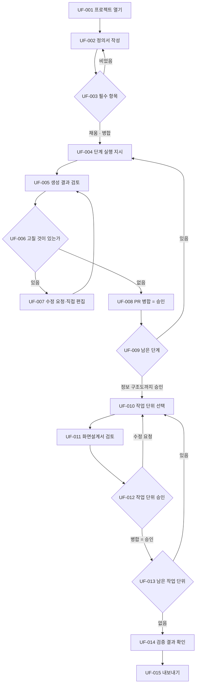

# 유저 플로우: AI UX 설계 자동화 시스템

## 1. 문서 개요

이 문서는 이 시스템을 쓰는 사람의 행동 흐름을 UF 항목으로 적습니다. 기획자가 프로젝트 정의서를 넣고, 단계를 실행하고, 생성 결과를 검토·수정·승인하고, 작업 단위를 골라 화면설계서를 받아 내보내기까지를 다룹니다.

| 항목 | 내용 |
| --- | --- |
| 상태 | 검토 필요. Claude가 쓴 초안입니다. |
| ID 규칙 | UF-000. 한 번 붙인 ID는 바꾸거나 재사용하지 않습니다. |
| 짝이 되는 문서 | [워크 플로우](05-workflow.md). 단계마다 대응하는 시스템 처리가 있습니다(POL-012). |
| 처리용 데이터 | 아직 없습니다. `user-flow.json`은 화면 배정(`screen`)이 필요해 [정보 구조도](06-information-architecture.md)를 쓴 뒤에 만듭니다. |

실행 자리는 [기능 정의서](03-functional-spec.md) 7절을 따릅니다. 사용자는 터미널을 쓰지 않고 브라우저 세 곳에서만 일합니다(REQ-024).

| 자리 | 사용자가 하는 일 |
| --- | --- |
| 세션 | claude.ai/code. 단계 실행 지시, 작업 단위 선택, 대화하며 수정 요청 |
| GitHub | 프로젝트 정의서 작성, 문서 편집, PR 검토와 병합(승인) |
| 뷰어 | UX AI Studio. 진행 현황, 문서, 플로우, 화면설계서, 검증 결과 보기 |

## 2. 사용자와 진입 경로

사용자 유형은 [프로젝트 정의서](00-project-definition.md) 3절을 따릅니다.

| 사용자 | 들어오는 곳 | 주로 하는 일 |
| --- | --- | --- |
| 기획자 | 뷰어의 프로젝트 목록, 또는 세션에서 저장소 열기 | 주 흐름 전체 (UF-001~015) |
| UI 블록 담당자 | 블록 레지스트리의 등록 요청 목록 | 신규 블록 등록 요청 처리 (UF-018) |
| 개발·QA 담당자 | 뷰어의 화면설계서, 내보낸 파일 | 승인된 산출물 넘겨받기 (UF-017) |

## 3. 주 흐름

유형은 [데이터 규격](08-data-spec.md)의 `step_type`(진입, 선택, 분기, 완료, 이탈)을 따릅니다. 분기에는 근거가 되는 정책을 답니다(QA-03).

| ID | 단계 | 유형 | 자리 | 하는 일 | 다음 | 참조 |
| --- | --- | --- | --- | --- | --- | --- |
| UF-001 | **프로젝트 열기** | 진입 | 뷰어, 세션 | 뷰어의 프로젝트 목록에서 프로젝트를 고르거나, 세션에서 저장소를 연다. 새 프로젝트는 세션에 지시해 만든다. | UF-002 | REQ-001, REQ-002, FN-101, FN-103 |
| UF-002 | **프로젝트 정의서 작성** | 선택 | GitHub | 저장소의 템플릿으로 정의서를 쓰거나 이미 쓴 PROJECT.md를 올리고 PR을 연다. | UF-003 | REQ-001, POL-032, FN-102 |
| UF-003 | **필수 항목 검사** | 분기 | GitHub | 검증 스크립트가 필수 항목을 검사한다. 비어 있으면 확정할 수 없다. 채웠으면 PR을 병합해 정의서를 확정한다. | 비었음 → UF-002 채움 → UF-004 | REQ-001, POL-032, POL-007 |
| UF-004 | **단계 실행 지시** | 선택 | 세션 | 실행할 단계를 세션에 지시한다. 총괄 에이전트가 시작 조건을 확인하고 담당 에이전트를 실행한다. 조건이 안 되면 무엇이 막혔는지 알려 준다. | UF-005 | REQ-003, REQ-006, POL-007, POL-008, POL-011, FN-601 |
| UF-005 | **생성 결과 검토** | 선택 | 뷰어, GitHub | 뷰어에서 문서와 참조 관계, 플로우 다이어그램을 보고, PR에서 줄 단위로 무엇이 바뀌었는지 본다. | UF-006 | REQ-009, REQ-011, REQ-013, FN-201, FN-202 |
| UF-006 | **고칠 것이 있는가** | 분기 | 뷰어, GitHub | 검토 결과에 따라 갈린다. | 있음 → UF-007 없음 → UF-008 | REQ-009, POL-006 |
| UF-007 | **수정 요청 또는 직접 편집** | 선택 | 세션, GitHub | 세션에 의견을 말하거나 PR에 줄 단위 의견을 남겨 재생성을 요청한다. 직접 고쳐도 되며, 고친 항목은 사람이 쓴 것으로 표시되어 덮어쓰이지 않는다. | UF-005 | REQ-009, POL-010, FN-203, FN-204, FN-407 |
| UF-008 | **승인** | 선택 | GitHub | PR을 병합한다. 병합이 그 문서의 승인이다. 선행 문서가 모두 승인되어야 병합할 수 있다. | UF-009 | REQ-010, POL-002, POL-003, POL-004, POL-031, FN-205 |
| UF-009 | **남은 단계가 있는가** | 분기 | 뷰어 | 요구사항 → 정책 → 플로우 → 정보 구조도 순으로 남은 단계가 있는지 본다. 정보 구조도까지 승인되면 화면설계서로 넘어간다. | 있음 → UF-004 없음 → UF-010 | REQ-002, POL-004, POL-005, FN-103 |
| UF-010 | **작업 단위 선택** | 선택 | 세션, 뷰어 | 승인된 정보 구조도의 작업 단위 목록과 상태를 보고 작성할 작업 단위를 고른다. 대기나 수정 필요인 것만 고를 수 있다. | UF-011 | REQ-026, POL-037, FN-206 |
| UF-011 | **작업 단위의 화면설계서 검토** | 선택 | 뷰어, GitHub | 뷰어에서 동작하는 화면과 영역별 정책·디스크립션·예외 케이스를 보고, PR에서 변경 내역을 본다. | UF-012 | REQ-009, REQ-012, FN-301, FN-201 |
| UF-012 | **작업 단위 승인** | 분기 | 뷰어, GitHub | 고칠 것이 있으면 수정을 요청하고, 없으면 PR을 병합해 그 작업 단위를 승인한다. | 수정 요청 → UF-010 승인 → UF-013 | REQ-010, REQ-026, POL-002, POL-038, FN-205 |
| UF-013 | **남은 작업 단위가 있는가** | 분기 | 뷰어 | 대기나 수정 필요인 작업 단위가 남았는지 본다. 모두 승인되면 화면설계서 단계가 끝난다. | 있음 → UF-010 없음 → UF-014 | REQ-026, POL-038, FN-103 |
| UF-014 | **검증 결과 확인** | 선택 | 뷰어, 세션 | 최종 검증을 실행하고 규칙 7개의 결과와 요구사항 반영률을 본다. 실패 항목이 있으면 수정을 요청한다. | 실패 → UF-004 통과 → UF-015 | REQ-017, POL-021, POL-039, FN-801, FN-802 |
| UF-015 | **내보내기** | 완료 | 뷰어, 세션 | 승인된 화면설계서를 PPTX나 Figma로, 유저 플로우를 PNG로 내보낸다. | 끝 | REQ-013, REQ-014, POL-027, FN-302 |

## 4. 보조 흐름

| ID | 단계 | 유형 | 자리 | 하는 일 | 참조 |
| --- | --- | --- | --- | --- | --- |
| UF-016 | **변경 영향 확인과 재생성** | 선택 | 뷰어, 세션 | 승인된 항목이 바뀌면 뷰어의 변경 영향 화면에서 영향받는 산출물과 판정(수정 필요, 검토 필요)을 본다. 재생성은 사람이 세션에서 실행한다. | REQ-015, REQ-016, POL-018, POL-019, POL-020, FN-702, FN-703 |
| UF-017 | **승인된 산출물 넘겨받기** | 완료 | 뷰어 | 개발·QA 담당자가 승인된 화면설계서를 뷰어에서 보거나 내보낸 파일로 받는다. | REQ-012, REQ-014, POL-027 |
| UF-018 | **신규 블록 등록 요청 처리** | 선택 | 블록 레지스트리 | UI 블록 담당자가 화면 생성 중 들어온 등록 요청(BRQ)을 보고 표준 블록으로 등록하거나 돌려보낸다. | REQ-008, POL-024, POL-025, FN-503 |

## 5. 이탈

| ID | 단계 | 유형 | 자리 | 언제 | 그 뒤 | 참조 |
| --- | --- | --- | --- | --- | --- | --- |
| UF-019 | **사용량 한도로 중단** | 이탈 | 세션 | 실행 중 Max 플랜의 한도에 닿아 세션이 멈춘다. | 한도가 초기화되면 저장소의 파일을 읽어 멈춘 자리부터 잇는다. 추가 크레딧은 쓰지 않는다. | REQ-020, POL-029 |
| UF-020 | **검토 보류** | 이탈 | GitHub | 검토자가 판단을 미루고 PR을 열어 둔 채 떠난다. | 그 문서는 검토 필요에 머물고 다음 단계의 확정 입력이 되지 않는다. 초안 생성은 이어 갈 수 있다. | REQ-010, POL-004, POL-007 |

## 6. 분기와 연결된 정책

분기마다 근거가 되는 정책입니다. 정책과 연결되지 않은 분기는 없어야 합니다(QA-03).

| 분기 | 근거 정책 | 정책이 정하는 것 |
| --- | --- | --- |
| UF-003 필수 항목 검사 | POL-032, POL-007 | 정의서는 사람이 쓰고, 확정 전에는 Requirements Agent를 시작하지 않는다 |
| UF-006 고칠 것이 있는가 | POL-006 | 승인된 문서를 사람이 편집하면 변경으로 기록하고 영향 분석을 시작한다 |
| UF-009 남은 단계가 있는가 | POL-004, POL-005 | 선행 문서가 모두 승인되어야 승인할 수 있고, 한 단계에 문서가 둘이면 둘 다 승인되어야 완료된다 |
| UF-012 작업 단위 승인 | POL-002, POL-038 | 승인은 사람만 하고, 화면설계서는 작업 단위별로 승인한다 |
| UF-013 남은 작업 단위가 있는가 | POL-038 | 모든 작업 단위가 승인되어야 화면설계서 단계가 완료된다 |
| UF-014 검증 결과 확인 | POL-021, POL-039 | 규칙 7개를 모두 통과해야 최종 승인이 열린다 |

## 7. 워크 플로우와의 대응

사용자의 행동마다 대응하는 시스템 처리입니다(POL-012). 비어 있는 자리는 [워크 플로우](05-workflow.md)에 그 처리가 아직 없다는 뜻입니다.

| 유저 플로우 | 워크 플로우 |
| --- | --- |
| UF-002, UF-003 정의서 작성과 확정 | WF-011 |
| UF-004 단계 실행 지시 | WF-012, WF-013 |
| UF-005 생성 결과 검토 | WF-014 |
| UF-007 수정 요청 | WF-013 (재실행) |
| UF-008 승인 | WF-015 |
| 정보 구조도 검토와 승인 (UF-005~008 중 정보 구조도 차례) | WF-001, WF-002, WF-003 |
| UF-010 작업 단위 선택 | WF-004, WF-005 |
| UF-011 화면설계서 검토 | WF-006, WF-007 |
| UF-012 작업 단위 승인 | WF-008 |
| UF-013 남은 작업 단위 | WF-009 |
| UF-014 검증 결과 확인 | WF-019 |
| UF-016 변경 영향 확인과 재생성 | WF-010, WF-016, WF-017, WF-018 |
| UF-015 내보내기 | 없음. 뷰어에서 끝나고 저장소를 바꾸지 않습니다. |
| UF-018 블록 등록 요청 처리 | 없음. 블록 레지스트리의 흐름이며 이 시스템 밖입니다. |

## 8. 미정 사항

- [ ] 화면 배정. `user-flow.json`의 `screen` 필드는 [정보 구조도](06-information-architecture.md)를 쓸 때 IA Agent가 채웁니다.
- [ ] UF-010에서 작업 단위를 여러 개 골랐을 때의 진행 순서 (워크 플로우 9절)
- [ ] UF-014의 최종 검증을 사람이 실행할지 모든 작업 단위 승인 뒤 자동으로 할지
- [ ] UF-018을 이 시스템의 흐름으로 둘지 블록 레지스트리로 넘길지
- [ ] 이 문서의 단계 구성의 확정. Claude의 제안입니다.

## 변경 이력

| 버전 | 날짜 | 변경 내용 |
| --- | --- | --- |
| 0.0.0 | 2026-11-25 | 자리 만듦 |
| 0.0.1 | 2026-11-25 | 웹 구동 방식 확정으로 선행 조건이 풀린 것을 반영 |
| 0.1.0 | 2026-11-25 | 최초 작성. 주 흐름 UF-001~015, 보조 흐름 3개, 이탈 2개, 분기별 정책과 워크 플로우 대응 |
