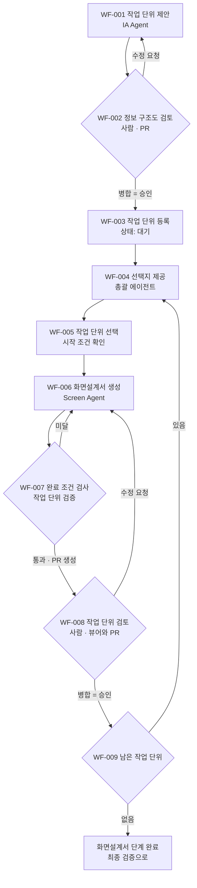

# 워크 플로우: AI UX 설계 자동화 시스템

## 1. 문서 개요

이 문서는 시스템이 처리하는 흐름을 WF 항목으로 적습니다. 이번 판은 작업 단위를 정의하는 데서 화면설계서를 승인하기까지만 다룹니다.

흐름의 뼈대는 2026-11-25에 사용자가 정했습니다. 정보 구조도에서 IA Agent가 화면을 작업 단위(예: 홈)로 묶어 제안하고, 사람이 승인하면 그것이 선택지가 되며, 사용자가 고른 작업 단위의 화면설계서를 작성합니다([결정 기록](decisions.md)).

| 항목 | 내용 |
| --- | --- |
| 상태 | 검토 필요. Claude가 쓴 초안입니다. 흐름의 뼈대는 확정된 결정이고, 단계별 처리 내용은 제안입니다. |
| ID 규칙 | WF-000. 한 번 붙인 ID는 바꾸거나 재사용하지 않습니다. |
| 다루는 범위 | 정보 구조도 생성(작업 단위 제안)부터 작업 단위별 화면설계서 승인, 작업 단위 구성 변경까지 |
| 아직 쓰지 않은 것 | 요구사항·정책·플로우 단계의 실행, 변경 처리 전반, 최종 검증 (8절) |
| 처리용 데이터 | 아직 없습니다. `workflow.json`은 대응하는 유저 플로우 단계(`user_step`)가 있어야 해서 [유저 플로우](04-user-flow.md)를 쓴 뒤에 만듭니다. |

실행 자리는 [기능 정의서](03-functional-spec.md) 7절을 따릅니다. 에이전트 실행은 claude.ai/code 세션, 검토와 승인은 GitHub PR, 산출물 보기는 뷰어입니다.

## 2. 흐름 한눈에 보기



WF-010(작업 단위 구성 변경)은 승인된 정보 구조도가 바뀔 때 따로 일어납니다.

## 3. 처리 단계

유형은 [데이터 규격](08-data-spec.md)의 `step_type`(처리, 검증, 상태 변경, 연동)을 따릅니다.

| ID | 처리 | 유형 | 주체 · 자리 | 읽는 것 → 쓰는 것 | 상태 변경 | 참조 |
| --- | --- | --- | --- | --- | --- | --- |
| WF-001 | **작업 단위 제안**<br>정보 구조도를 만들면서 화면(SCR)을 작업 단위(WU)로 묶고, 묶은 근거를 적는다. | 처리 | IA Agent · 세션 | user-flow.json, workflow.json, requirements.json → ia.json(`work_units`), IA.md | 정보 구조도: 생성 중 → 검토 필요 | REQ-025, POL-035, POL-036, FN-405, FN-408 |
| WF-002 | **정보 구조도와 작업 단위의 검토**<br>사람이 PR에서 화면 목록과 작업 단위 구성을 검토한다. 직접 고치거나 수정을 요청할 수 있고, PR 병합이 승인이다. | 상태 변경 | 사람 · GitHub PR, 뷰어 | ia.json, IA.md → (고친 경우) ia.json | 정보 구조도: 검토 필요 → 승인 | REQ-010, REQ-025, POL-002, POL-004, POL-035, FN-203, FN-204, FN-205 |
| WF-003 | **작업 단위 등록**<br>정보 구조도가 승인되면 작업 단위마다 화면설계서 상태를 대기로 등록한다. 이때부터 작업 단위가 선택지가 된다. | 상태 변경 | 스크립트 · PR 병합 뒤 | ia.json → status.json(`work_units`) | 작업 단위: 대기로 등록 | REQ-026, POL-037, POL-038 |
| WF-004 | **선택지 제공**<br>사용자가 화면설계서 작성을 요청하면 승인된 작업 단위 목록을 상태와 함께 보여 준다. | 처리 | 총괄 에이전트 · 세션. 목록과 상태는 뷰어에서도 본다 | ia.json, status.json → 쓰지 않음 | 없음 | REQ-026, POL-037, FN-206, FN-601 |
| WF-005 | **작업 단위 선택과 시작 조건 확인**<br>사용자가 작업 단위를 하나 이상 고른다. 고른 작업 단위가 승인된 정보 구조도에 있는지, 상태가 대기 또는 수정 필요인지 확인하고 실행을 기록한다. | 검증 | 사용자, 총괄 에이전트 · 세션 | status.json → status.json, runs.json | 작업 단위: 대기·수정 필요 → 생성 중 | REQ-026, REQ-018, POL-037, POL-033, FN-206, FN-601, FN-603 |
| WF-006 | **화면설계서 생성**<br>고른 작업 단위의 화면마다 UI 블록을 배치하고 요구사항·정책을 연결하며 인터랙션과 예외 상황을 적는다. 다른 작업 단위의 화면 파일은 고치지 않는다. | 처리 | Screen Agent · 세션 | 모든 선행 문서, ia.json, UI 블록 라이브러리 → screens/SCR-000.json, STORYBOARD.md | 없음 | REQ-007, REQ-012, POL-009, POL-017, POL-022, POL-023, POL-026, POL-037, FN-406, FN-501, FN-502 |
| WF-007 | **완료 조건 검사와 작업 단위 검증**<br>고른 작업 단위의 모든 화면에 화면 파일이 있는지, 영역마다 블록·요구사항·정책·예외 상황이 있는지 검사하고, 그 작업 단위 범위에서 QA-02~05와 QA-07을 판정한다. 통과하면 브랜치에 푸시하고 PR을 연다. | 검증 | 검증 스크립트, QA Agent · 세션 | screens/SCR-000.json, ia.json, policies.json → validation.json, QA-REPORT.md | 작업 단위: 생성 중 → 검토 필요 | REQ-017, POL-008, POL-039, FN-601, FN-801, FN-802 |
| WF-008 | **작업 단위 검토와 승인**<br>사람이 뷰어에서 동작하는 화면을 보고 PR에서 검토한다. PR 병합이 그 작업 단위의 승인이다. | 상태 변경 | 사람 · 뷰어, GitHub PR | screens/SCR-000.json → status.json | 작업 단위: 검토 필요 → 승인 | REQ-009, REQ-010, POL-002, POL-038, FN-201, FN-205, FN-301 |
| WF-009 | **다음 작업 단위 또는 단계 완료**<br>대기나 수정 필요인 작업 단위가 남았으면 WF-004로 돌아간다. 모든 작업 단위가 승인됐으면 화면설계서 단계가 완료되고 최종 검증을 시작할 수 있다. | 상태 변경 | 스크립트 · PR 병합 뒤, 총괄 에이전트 · 세션 | status.json → status.json | 화면설계서: 모든 작업 단위가 승인이면 승인 | POL-038, POL-021, FN-103, FN-803 |
| WF-010 | **작업 단위 구성 변경**<br>승인된 정보 구조도에서 작업 단위에 화면이 더해지거나 옮겨지면 변경으로 기록하고, 영향받는 작업 단위의 화면설계서를 수정 필요로 바꾼다. 새 작업 단위는 대기로 등록한다. | 상태 변경 | 스크립트 · PR 병합 뒤, 총괄 에이전트 · 세션 | ia.json → changes.json, status.json | 작업 단위: 승인 → 수정 필요 | REQ-015, POL-006, POL-018, POL-033, FN-701, FN-702, FN-704 |

## 4. 분기와 예외

| 조건 | 단계 | 처리 | 참조 |
| --- | --- | --- | --- |
| 어느 작업 단위에도 속하지 않는 화면이 있거나 두 곳에 속한 화면이 있다 | WF-001 | 완료 조건 미달이다. 검토로 넘기지 않고 IA Agent를 다시 실행한다. | POL-008, POL-036 |
| 사람이 작업 단위 구성을 직접 고쳤다 | WF-002 | 고친 작업 단위를 사람이 고친 항목으로 표시하고, 다시 생성할 때 덮어쓰지 않는다. | POL-010 |
| 정보 구조도에 수정을 요청했다 | WF-002 | 의견을 IA Agent의 재생성 입력으로 넘기고 WF-001로 돌아간다. | FN-204, FN-407 |
| 정보 구조도가 승인 전이다 | WF-004 | 선택지를 주지 않고, 정보 구조도 승인이 먼저라고 알린다. | POL-037 |
| 고른 작업 단위가 이미 승인 상태다 | WF-005 | 다시 작성할지 사용자에게 확인한다. 다시 작성하면 승인이 풀린다. | POL-019 |
| 고른 작업 단위가 검토 필요 상태다 | WF-005 | 시작하지 않고 열려 있는 PR을 알린다. | POL-037 |
| 맞는 UI 블록이 없다 | WF-006 | 프로젝트 블록으로 만들고 등록 요청을 남긴 뒤 계속한다. | REQ-008, POL-024, FN-503 |
| 한도에 닿아 실행이 멈췄다 | WF-006 | 실행 기록에 중단으로 남긴다. 작업 단위는 생성 중으로 두고, 다시 실행하면 이미 만든 화면 파일 다음부터 잇는다. | POL-029 |
| 완료 조건이나 검증 규칙을 채우지 못했다 | WF-007 | PR을 열지 않고 Screen Agent를 다시 실행한다. 다른 문서의 문제면 총괄 에이전트가 담당 에이전트에 넘긴다. | POL-008, POL-009, POL-011 |
| 작업 단위에 수정을 요청했다 | WF-008 | 지정한 화면만 다시 만들고 WF-007부터 다시 거친다. | FN-204, FN-407, POL-019 |
| 작업 단위가 없어졌다 | WF-010 | 그 작업 단위를 폐기로 표시하고 지우지 않는다. 화면은 옮겨 간 작업 단위에서 다룬다. | POL-018 |

## 5. 작업 단위의 상태

작업 단위는 화면설계서 문서의 상태 다섯 가지([기능 정의서](03-functional-spec.md) 6절)를 작업 단위마다 따로 갖습니다. 사용자가 고를 수 있는 것은 대기와 수정 필요인 작업 단위입니다.

| 상태 | 뜻 | 이 상태로 만드는 처리 |
| --- | --- | --- |
| 대기 | 정보 구조도가 승인되어 고를 수 있음 | WF-003, WF-010의 새 작업 단위 |
| 생성 중 | Screen Agent가 작성하는 중 | WF-005 |
| 검토 필요 | 초안과 PR이 있고 사람의 검토를 기다림 | WF-007 |
| 승인 | 사람이 PR을 병합함 | WF-008 |
| 수정 필요 | 승인 뒤에 작업 단위 구성이나 참조하던 항목이 바뀜 | WF-010 |

에이전트는 상태를 승인으로 쓸 수 없습니다(POL-002). 승인은 PR 병합 뒤 스크립트가 기록합니다.

## 6. 데이터 예시

작업 단위 이름과 화면은 설명을 위한 가상의 예입니다. 필드는 [데이터 규격](08-data-spec.md) 4절과 5절을 따릅니다.

`ia.json`의 작업 단위입니다.

```json
"work_units": [
  {
    "id": "WU-001",
    "title": "홈",
    "description": "앱에 들어와 처음 보는 화면과 거기서 바로 열리는 화면",
    "screens": ["SCR-001", "SCR-002"],
    "refs": ["UF-001"],
    "origin": "ai",
    "updated_at": "2026-11-25"
  },
  {
    "id": "WU-002",
    "title": "주문/결제",
    "description": "장바구니에서 결제 완료까지",
    "screens": ["SCR-003", "SCR-004", "SCR-005"],
    "refs": ["UF-004", "UF-005"],
    "origin": "ai",
    "updated_at": "2026-11-25"
  }
]
```

`_meta/status.json`의 화면설계서 줄입니다. 홈은 승인됐고 주문/결제는 아직 고르지 않은 상태입니다.

```json
{
  "doc": "SB",
  "state": "검토 필요",
  "work_units": [
    { "id": "WU-001", "state": "승인", "approved_by": "github-user", "approved_at": "2026-11-25", "pr": 12 },
    { "id": "WU-002", "state": "대기", "approved_by": null, "approved_at": null, "pr": null }
  ]
}
```

이 상태에서 사용자가 화면설계서 작성을 요청하면 선택지는 "주문/결제 (대기)" 하나이고, 홈은 승인된 작업 단위로 함께 보입니다.

## 7. 유저 플로우와의 대응

[유저 플로우](04-user-flow.md)는 아직 쓰지 않았습니다. 사용자의 행동이 들어가는 처리는 세 곳이며, 유저 플로우를 쓸 때 여기에 대응하는 단계를 만듭니다.

| 사용자의 행동 | 워크 플로우 | 자리 |
| --- | --- | --- |
| 작업 단위 구성을 검토하고 고치거나 승인한다 | WF-002 | GitHub PR, 뷰어 |
| 작성할 작업 단위를 고른다 | WF-005 | 세션 |
| 작업 단위의 화면설계서를 검토하고 수정을 요청하거나 승인한다 | WF-008 | 뷰어, GitHub PR |

## 8. 아직 쓰지 않은 흐름

- 프로젝트 정의서 확정에서 유저 플로우·워크 플로우 생성까지의 단계 실행
- 변경 처리 전반: 변경 기록, 영향 분석, 부분 재생성, 승인 해제
- 최종 검증과 프로젝트 승인

## 9. 미정 사항

- [ ] 화면을 작업 단위로 묶는 기준과 공통 화면의 처리 (POL-036)
- [ ] 작업 단위를 여러 개 골랐을 때 차례로 할지 나란히 할지. Max 한도를 생각하면 차례로 하는 쪽이 안전합니다(제안).
- [ ] 작업 단위 하나에 PR 하나로 할지. 이 문서는 작업 단위마다 PR 하나로 썼습니다(제안).
- [ ] 승인된 작업 단위를 다시 작성할 때의 확인 절차
- [ ] 작업 단위 검증에서 판정할 규칙의 범위 (POL-039)
- [ ] 이 문서의 단계별 처리 내용의 확정. Claude의 제안입니다.

## 변경 이력

| 버전 | 날짜 | 변경 내용 |
| --- | --- | --- |
| 0.0.0 | 2026-11-25 | 자리 만듦 |
| 0.0.1 | 2026-11-25 | 웹 구동 방식 확정으로 선행 조건이 풀린 것을 반영 |
| 0.1.0 | 2026-11-25 | 작업 단위 정의에서 화면설계서 승인까지 WF-001~010을 작성 |
