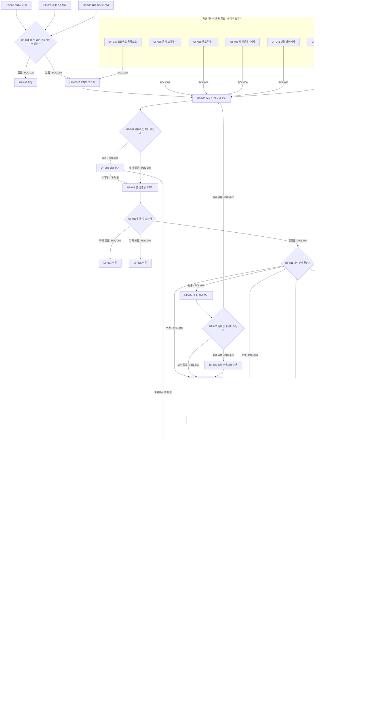

# 유저 플로우: UX AI Studio

> **Flow Agent가 만든 초안입니다. 사람의 승인 전입니다.**
> 승인은 사람이 PR을 병합할 때만 일어납니다(POL-002).

## 1. 문서 개요

이 문서는 뷰어를 쓰는 사람의 행동 흐름을 UF 항목으로 적습니다. 짝이 되는 [워크 플로우](WORKFLOW.md)와
함께 정의했으며, 한쪽을 끝내고 다른 쪽을 쓰지 않았습니다(POL-012, 에이전트 명세 2절).

| 항목 | 내용 |
| --- | --- |
| 상태 | 검토 필요 |
| ID 규칙 | `UF-000`. 1번부터 차례로 붙이고 비는 번호를 두지 않습니다. 한 번 붙인 ID는 바꾸거나 재사용하지 않습니다. |
| 단계 유형 | 진입, 선택, 분기, 완료, 이탈 |
| 분기 조건 | 스스로 정하지 않았습니다. 모든 분기의 갈래에 [정책서](POLICY.md)의 `POL` 하나를 달았습니다. |
| 화면 배정 | 0.2.0에서 IA Agent가 진입·선택·완료 단계에 채웠습니다. 0.3.0에서 더한 여섯 단계는 이미 있는 화면에 걸리므로 같은 규칙으로 채웠습니다(8절). 새 화면은 만들지 않았습니다. |
| 짝이 되는 문서 | [워크 플로우](WORKFLOW.md). 이탈을 뺀 모든 단계에 대응하는 처리가 있습니다. |
| 처리용 데이터 | [user-flow.json](user-flow.json) |

단계는 42개입니다. 진입 3개, 선택 22개, 분기 9개, 완료 4개, 이탈 4개입니다.

0.3.0에서 여섯을 더했습니다. [검증 보고서](QA-REPORT.md) 5절의 QA-03이 **화면설계서에는 그려졌는데
플로우에 대응 단계가 없는 길** 여섯을 짚었고, 화면이 이미 그렇게 그려졌으므로 플로우를 화면에
맞췄습니다. 하나는 참조를 따라 다른 산출물로 옮겨 가는 길(3.3절 UF-036)이고, 다섯은 화면 머리의
되돌아가기(3.7절 UF-037~041)입니다. 화면을 바꿔 달라고 하지 않았습니다.

0.4.0에서 하나(UF-042)를 더했습니다. 재검증(QA 0.2.0)이 **SCR-006의 머리 뒤로가기**에도 대응
단계가 없다고 짚었습니다. 전 판은 'UF-025 결과 없음 → UF-006'을 그 자리로 보았으나, 그것은
사용자가 머리를 누른 것이 아니라 판정의 결과입니다. 3.7절에서 둘을 가른 기준 그대로이므로
UF-038~041과 같은 꼴로 단계를 세웠습니다.

뷰어는 읽기 전용이라 이 플로우에 저장소를 고치는 단계가 없습니다(REQ-015, POL-001). 편집·승인·실행이
필요한 자리는 링크로 바깥에 넘기고, 사용자가 실제로 나가면 이탈(UF-032)로 봅니다.

## 2. 사용자와 진입 경로

사용자 유형은 [프로젝트 정의서](PROJECT.md) 3절을 따릅니다. 셋 다 프로젝트 목록을 거쳐 들어옵니다(POL-008).

| 사용자 | 들어오는 곳 | 주로 도는 길 |
| --- | --- | --- |
| 기획자 | UF-001 뷰어의 프로젝트 목록 | 주 흐름 전체 (UF-004~031) |
| 개발·QA 담당자 | UF-002 승인된 화면설계서를 받으러 | 화면설계서와 PPTX (UF-019~023, UF-030) |
| UI 블록 담당자 | UF-003 블록 사용 현황을 보러 | 영역과 블록 (UF-019~021) |

## 3. 주 흐름

머리의 다섯 단계(UF-037~041)에는 **들어오는 화살표가 없습니다.** 헤더는 화면 하나 전체에 걸려
있어 그 화면에 배정된 어느 단계에서나 눌리기 때문입니다. 한 단계의 `next`로 적으면 그 단계를
지난 뒤에만 눌리는 것처럼 읽힙니다. 까닭과 남은 결정은 3.7절과 9절에 적었습니다.

### 3.1 진입과 프로젝트 고르기

| ID | 단계 | 유형 | 행위자 | 하는 일 | 다음 | 참조 |
| --- | --- | --- | --- | --- | --- | --- |
| UF-001 | **기획자가 뷰어에 들어온다** | 진입 | 기획자 | 뷰어를 열면 볼 수 있는 프로젝트 목록이 먼저 보인다. | UF-004 | REQ-001, POL-008, POL-020 |
| UF-002 | **개발·QA 담당자가 산출물을 받으러 들어온다** | 진입 | 개발·QA 담당자 | 승인된 화면설계서를 넘겨받으려고 뷰어를 연다. | UF-004 | REQ-012, POL-005, POL-008 |
| UF-003 | **UI 블록 담당자가 블록 사용 현황을 보러 들어온다** | 진입 | UI 블록 담당자 | 화면이 어떤 블록을 썼고 등록 요청이 무엇인지 확인하려고 뷰어를 연다. | UF-004 | REQ-011, POL-008, POL-016 |
| UF-004 | **볼 수 있는 프로젝트가 있는가** | 분기 | 셋 모두 | 권한과 프로젝트 폴더에 따라 목록을 보일 수 있는지가 갈린다. | 있음 → UF-005 (POL-008) 없음 → UF-033 (POL-020) | REQ-001, REQ-019, POL-008, POL-020 |
| UF-005 | **프로젝트를 골라 진행 현황으로 들어간다** | 선택 | 기획자 | 이름과 현재 진행 상태를 보고 프로젝트 하나를 고른다. | UF-006 | REQ-001, REQ-002, POL-008 |

### 3.2 진행 현황

| ID | 단계 | 유형 | 행위자 | 하는 일 | 다음 | 참조 |
| --- | --- | --- | --- | --- | --- | --- |
| UF-006 | **일곱 단계의 진행 상태를 본다** | 선택 | 기획자 | 정의서·요구사항·정책·플로우·정보 구조도·화면설계서·검증의 상태와 진행 중인 단계를 한 화면에서 읽는다. | UF-007 | REQ-002, POL-005, POL-006 |
| UF-007 | **사람을 기다리는 것이 있는가** | 분기 | 기획자 | 확정 대기·승인 대기·선택 대기가 있는지에 따라 갈린다. | 있음 → UF-008 (POL-007) 대기 없음 → UF-009 (POL-007) | REQ-003, POL-007 |
| UF-008 | **기다리는 자리의 링크를 연다** | 선택 | 기획자 | 고칠 것은 GitHub, 실행·수정 요청은 세션으로 가는 링크를 누른다. 링크는 새 탭에서 열리고 뷰어 화면은 그대로 남는다. | 바깥에서 이어 함 → UF-032 (POL-003) 뷰어에서 계속 봄 → UF-009 (POL-003) | REQ-004, REQ-016, POL-001, POL-002, POL-003 |
| UF-009 | **볼 산출물을 고른다** | 선택 | 기획자 | 진행 현황의 단계에서 읽을 산출물 하나를 고른다. | UF-010 | REQ-005, POL-004, POL-006 |
| UF-010 | **그 산출물을 읽을 수 있는가** | 분기 | 기획자 | 파일이 있는지, 읽히는지에 따라 갈린다. 뷰어는 파일에 없는 값을 만들지 않는다. | 읽었음 → UF-011 (POL-004) 비어 있음 → UF-034 (POL-004) 읽지 못함 → UF-035 (POL-004) | REQ-005, REQ-020, POL-003, POL-004 |
| UF-011 | **어떤 산출물인가** | 분기 | 기획자 | 산출물의 종류에 따라 보는 화면이 갈린다. | 문서 → UF-012 (POL-009) 플로우 → UF-015 (POL-012) 화면설계서 → UF-019 (POL-014) 검증 → UF-024 (POL-018) 변경 → UF-027 (POL-019) | REQ-005, POL-006, POL-009, POL-012, POL-014, POL-018, POL-019 |

### 3.3 문서와 참조

| ID | 단계 | 유형 | 행위자 | 하는 일 | 다음 | 참조 |
| --- | --- | --- | --- | --- | --- | --- |
| UF-012 | **문서를 항목 단위로 읽는다** | 선택 | 기획자 | 항목마다 ID와 본문을 읽고 AI가 만든 것인지 사람이 고친 것인지 구분해 본다. | UF-013 | REQ-005, POL-005, POL-009 |
| UF-013 | **항목의 상위·하위 참조를 본다** | 선택 | 기획자 | 고른 항목이 참조하는 상위 항목과 그 항목을 참조하는 하위 항목을 함께 본다. | UF-014 | REQ-006, POL-010 |
| UF-014 | **고른 참조가 연결되어 있는가** | 분기 | 기획자 | 참조한 ID가 저장소에 있는지, 같은 문서 보기 안의 항목인지에 따라 갈린다. | 연결됨·같은 문서(REQ·POL·IA) → UF-013 (POL-011) 연결됨·다른 산출물(UF·WF·SCR) → UF-036 (POL-010) 끊김 → UF-012 (POL-011) 연결된 항목 없음 → UF-028 (POL-010) | REQ-006, REQ-013, POL-010, POL-011 |
| UF-036 | **참조를 따라 다른 산출물의 보기 화면으로 옮겨 간다** | 선택 | 기획자 | 고른 참조가 다른 산출물의 항목이면 그 산출물을 보는 화면으로 옮겨 간다. 누르는 자리는 문서 보기의 참조 패널이다. | UF·WF 항목 → UF-015 (POL-012) SCR 항목 → UF-019 (POL-014) | REQ-005, REQ-006, POL-010, POL-012, POL-014 |

**UF-036을 더한 까닭**(QA-03 1번). 0.2.0까지 UF-014의 '연결됨'은 UF-013으로만 돌아왔고 UF-013의
화면은 SCR-003입니다. 그래서 **참조를 따라 다른 화면으로 옮겨 가는 길이 플로우에 없었습니다.**
[정보 구조도](IA.md) 3절은 'SCR-003 → SCR-004'와 'SCR-003 → SCR-005'의 근거로 "UF-013, UF-014
연결됨"을 들었고, 화면설계서의 SCR-003-A04는 UF·WF 항목을 플로우 미리보기로, SCR 항목을
화면설계서 뷰어로 실제로 보냅니다. 그 길을 단계로 세웠습니다.

- `screen`은 **SCR-003**입니다. 누르는 자리가 문서 보기의 참조 패널이기 때문이며, UF-016(누르는
  자리는 SCR-004, 가는 곳은 SCR-003)을 배정한 규칙과 같습니다([정보 구조도](IA.md) 5절).
- 가는 곳은 새 단계를 만들지 않고 이미 있는 UF-015(플로우 다이어그램을 본다)와 UF-019(화면설계서를
  동작하는 화면으로 본다)로 보냅니다. 옮겨 간 뒤에 하는 일이 그 둘과 같기 때문입니다.
- 갈래에 건 정책은 UF-011이 같은 갈림에 건 것과 같습니다. 플로우는 POL-012, 화면설계서는
  POL-014입니다. UF-014의 새 갈래는 "목록의 항목을 누르면 그 항목으로 이동한다"는 POL-010입니다.

### 3.4 플로우와 PNG

| ID | 단계 | 유형 | 행위자 | 하는 일 | 다음 | 참조 |
| --- | --- | --- | --- | --- | --- | --- |
| UF-015 | **플로우 다이어그램을 본다** | 선택 | 기획자 | 유저 플로우와 워크 플로우를 저장소의 JSON 그대로 그린 다이어그램으로 본다. | UF-016 | REQ-007, POL-012 |
| UF-016 | **분기에 걸린 정책으로 옮겨 간다** | 선택 | 기획자 | 분기 연결의 조건과 정책 ID를 보고 정책 ID를 눌러 그 정책 항목으로 간다. | UF-017 | REQ-007, POL-010, POL-012 |
| UF-017 | **유저 플로우 PNG 내보내기를 누른다** | 선택 | 기획자 | 보고 있는 다이어그램을 PNG로 내려받는다. | UF-018 | REQ-008, POL-013, POL-021 |
| UF-018 | **PNG가 내려받아졌는가** | 분기 | 기획자 | 내보내기 결과에 따라 갈린다. | 내려받음 → UF-029 (POL-013) 실패 → UF-017 (POL-013) 비어 있음 → UF-015 (POL-013) | REQ-008, POL-013 |

### 3.5 화면설계서와 PPTX

| ID | 단계 | 유형 | 행위자 | 하는 일 | 다음 | 참조 |
| --- | --- | --- | --- | --- | --- | --- |
| UF-019 | **화면설계서를 동작하는 화면으로 본다** | 선택 | 기획자 | 화면설계서 JSON으로 그린 화면을 눌러 보며 인터랙션을 확인한다. | UF-020 | REQ-009, REQ-017, POL-014 |
| UF-020 | **영역의 정책·디스크립션·예외를 함께 읽는다** | 선택 | 기획자 | 고른 영역에 걸린 정책·디스크립션·예외를 화면과 나란히 읽고 ID를 눌러 그 항목으로 간다. | UF-021 | REQ-010, POL-015 |
| UF-021 | **영역이 쓴 블록이 어떤 것인가** | 분기 | UI 블록 담당자 | 영역이 참조한 블록이 라이브러리의 것인지, 등록 요청 중인지, 알 수 없는 것인지에 따라 갈린다. | 라이브러리 블록 → UF-022 (POL-016) 등록 요청 중 → UF-022 (POL-016) 알 수 없는 블록 → UF-032 (POL-016) | REQ-011, REQ-018, POL-016 |
| UF-022 | **화면설계서 PPTX 내보내기를 누른다** | 선택 | 기획자 | 화면설계서를 PPTX로 내보내 개발·QA에 넘긴다. | UF-023 | REQ-012, POL-017, POL-021 |
| UF-023 | **PPTX가 내려받아졌는가** | 분기 | 기획자 | 내보내기 결과에 따라 갈린다. | 내려받음 → UF-030 (POL-017) 실패 → UF-022 (POL-017) 내보낼 것 없음 → UF-019 (POL-021) | REQ-012, POL-017, POL-021 |

### 3.6 검증과 변경

| ID | 단계 | 유형 | 행위자 | 하는 일 | 다음 | 참조 |
| --- | --- | --- | --- | --- | --- | --- |
| UF-024 | **검증 결과 목록을 본다** | 선택 | 기획자 | 규칙마다 통과와 실패를, 실패한 항목의 ID를 목록으로 본다. | UF-025 | REQ-013, POL-018 |
| UF-025 | **실패한 항목이 있는가** | 분기 | 기획자 | 검증 결과에 따라 다음에 볼 것이 갈린다. | 실패 있음 → UF-026 (POL-018) 모두 통과 → UF-027 (POL-018) 결과 없음 → UF-006 (POL-018) | REQ-013, POL-018 |
| UF-026 | **실패 항목으로 옮겨 간다** | 선택 | 기획자 | 실패 항목을 눌러 해당 문서 항목이나 화면으로 간다. 끊긴 참조는 누를 수 없다. | UF-027 | REQ-013, POL-011, POL-018 |
| UF-027 | **변경 영향 목록에서 판정을 본다** | 선택 | 기획자 | 무엇이 바뀌었고 그 때문에 어디가 수정 필요·검토 필요인지 목록으로 본다. 영향받는 항목을 누르면 그 항목으로 간다. | 다 확인함 → UF-031 영향받는 항목으로 → UF-012 (POL-019) | REQ-014, REQ-006, POL-019, POL-010 |

### 3.7 화면 머리에서 되돌아가는 공통 경로

화면 머리(글로벌 헤더 BLK-0001)의 뒤로가기로 되돌아가는 여섯입니다. 다섯은 0.3.0에서
(QA-03 2~6번), UF-042는 0.4.0에서 더했습니다(재검증 QA-03). **일곱 화면 가운데 첫 화면인
SCR-001을 뺀 여섯이 모두 덮였습니다.** SCR-001에 더 위로 가는 뒤로가기를 두지 않는 것은
POL-008이 정했습니다.

| ID | 단계 | 유형 | 행위자 | 하는 일 | 다음 | 화면 | 참조 |
| --- | --- | --- | --- | --- | --- | --- | --- |
| UF-037 | **프로젝트 목록으로 돌아가 다른 프로젝트를 본다** | 선택 | 기획자 | 진행 현황 머리의 프로젝트 이름이나 뒤로가기를 눌러 목록으로 돌아간다. | UF-005 (POL-008) | SCR-002 | REQ-001, REQ-002, POL-008 |
| UF-038 | **문서 보기에서 진행 현황으로 돌아간다** | 선택 | 기획자 | 머리의 뒤로가기를 눌러 산출물을 고르는 자리로 돌아간다. 따라간 참조 자취는 버린다. | UF-006 (POL-006) | SCR-003 | REQ-002, REQ-005, POL-006 |
| UF-039 | **플로우 미리보기에서 진행 현황으로 돌아간다** | 선택 | 기획자 | 머리의 뒤로가기를 누른다. 다이어그램을 보던 상태는 버린다. | UF-006 (POL-006) | SCR-004 | REQ-002, REQ-007, POL-006 |
| UF-040 | **화면설계서 뷰어에서 진행 현황으로 돌아간다** | 선택 | 기획자 | 머리의 뒤로가기를 누른다. 고른 영역과 인터랙션으로 바뀐 화면 상태는 버린다. | UF-006 (POL-006) | SCR-005 | REQ-002, REQ-009, POL-006 |
| UF-041 | **변경 영향에서 진행 현황으로 돌아간다** | 선택 | 기획자 | 머리의 뒤로가기를 누른다. 검증 결과에서 들어왔어도 같은 자리로 돌아간다. | UF-006 (POL-006) | SCR-007 | REQ-002, REQ-014, POL-006 |
| UF-042 | **검증 결과에서 진행 현황으로 돌아간다** | 선택 | 기획자 | 머리의 뒤로가기를 누른다. 고른 규칙과 실패 항목 표시는 버린다. | UF-006 (POL-006) | SCR-006 | REQ-002, REQ-013, POL-006 |

#### 하나로 묶지 않고 화면마다 둔 까닭

QA-03 3~6번(SCR-003·004·005·007의 뒤로가기)은 누르는 자리도 가는 곳도 같습니다. 그래도 **하나의
공통 단계로 묶지 않고 넷으로 두었습니다.** 까닭은 셋입니다. 0.4.0의 UF-042(SCR-006)도 같은
까닭으로 다섯째를 만들지 않고 여섯째 단계로 두었습니다.

1. **`screen`이 한 값이기 때문입니다.** [데이터 규격](../../docs/08-data-spec.md) 4절이 단계의
   `screen`을 `string | null` 하나로 두었습니다. 넷을 묶으면 누르는 자리 넷 가운데 하나만 적게
   되고, 나머지 셋은 다시 '화면에는 있는데 플로우에 없는 길'이 됩니다. 지금 고치려는 실패를 그대로
   되살리는 꼴입니다. `screen`을 `null`로 두는 길도 있으나, 그러면 진입·선택·완료는 화면을 가져야
   한다는 규칙(QA-03)을 깨뜨립니다.
2. **워크 플로우가 한 줄로 적히지 않기 때문입니다.** 되돌아가기는 보는 화면을 바꾸는 처리이고
   `state_change`의 `from`이 넷 다 다릅니다(문서 보기·플로우 미리보기·화면설계서 뷰어·변경 영향).
   버리는 화면 상태도 다릅니다. WF-038은 참조 자취를, WF-039는 다이어그램 보기 상태를, WF-040은
   고른 영역과 화면 state를, WF-041은 고른 변경 줄을, WF-042는 고른 규칙과 실패 항목 표시를
   버립니다. 하나로 묶으면 `from`에 다섯 값을 적어야 하는데 그런 자리가 없습니다.
3. **UF와 WF의 일대일 대응을 지켜야 하기 때문입니다.** 묶으면 단계 하나에 처리 넷이 붙거나,
   처리 하나가 화면 넷을 맡습니다. 어느 쪽이든 QA-03이 통과로 둔 "UF 하나에 WF 하나"가 깨집니다.

#### UF-042와 'UF-025 결과 없음'은 다른 길이다 (0.4.0)

SCR-006에는 진행 현황으로 돌아오는 길이 **둘**입니다. 섞으면 안 되므로 갈라 적습니다.

| 길 | 누가 일으키나 | 단계 | 화면 | 처리 |
| --- | --- | --- | --- | --- |
| 검증 결과가 없어 돌아온다 | 뷰어의 판정 | UF-025의 '결과 없음' 갈래 (POL-018) | 분기라 `null` | WF-025 |
| 머리의 뒤로가기를 눌러 돌아온다 | 사용자 | **UF-042** (POL-006) | **SCR-006** | **WF-042** |

0.3.0에서는 앞의 것이 있으니 SCR-006을 덮었다고 보았으나 **그것이 틀렸습니다.** 판정의 결과는
사용자가 고른 행동이 아니고, 검증 결과가 **있을 때**는 일어나지도 않습니다. 결과가 있는 화면에서
머리를 누르면 갈 곳이 플로우에 없었습니다. 3.7절이 UF-037~041을 세운 기준("머리는 사용자가
누른다")을 SCR-006에만 적용하지 않은 셈이라, 재검증의 지적을 받아 UF-042를 세웠습니다.
`screens/SCR-006.json`의 `refs`에 UF-042를 더하는 일은 screen과 ia의 몫입니다.

#### 들어오는 갈래를 적지 않은 까닭

여섯 모두 **들어오는 `next`가 없습니다.** 머리는 화면 하나 전체에 걸려 있어 그 화면에 배정된 어느
단계에서나 눌립니다. 예를 들어 SCR-003의 뒤로가기는 UF-012에서도 UF-013에서도 UF-028에서도
눌립니다. 한 단계에만 갈래를 달면 나머지 자리에서는 못 누르는 것으로 읽히고, 모든 단계에 달면
완료 단계(UF-028·UF-029·UF-030)에까지 갈래가 생겨 '완료'가 끝이 아니게 됩니다. 그래서 나가는
갈래만 적고 들어오는 쪽은 이 절과 3절의 다이어그램으로 적어 두었습니다. 이 모양을 바꾸려면 단계의
`next` 말고 **화면 단위의 공통 경로를 적는 자리**가 있어야 하므로 9절에 넘깁니다.

#### UF-037은 왜 따로인가

UF-037(SCR-002 → SCR-001)은 가는 곳이 진행 현황이 아니라 프로젝트 목록이고, 거는 정책도
POL-006이 아니라 POL-008입니다. 다른 길이므로 따로 두었습니다. 다음은 UF-005(프로젝트를
골라 진행 현황으로 들어간다)로 보냈습니다. 목록으로 돌아가는 까닭이 **다른 프로젝트를 보려는
것**이기 때문입니다. UF-004(볼 수 있는 프로젝트가 있는가)로 보내지 않은 것은, 이미 프로젝트 하나를
열어 본 뒤라 '볼 수 있는 프로젝트가 없다'는 갈래가 다시 갈릴 자리가 아니기 때문입니다.

#### 건 정책과 넘기는 것

여섯 갈래에 건 정책은 POL-006(진행 현황은 일곱 단계를 한 화면에 보인다)과 POL-008(프로젝트
목록에서 진행 현황으로 들어간다)입니다. 산출물을 고르는 자리가 진행 현황 하나라는 것이 POL-006이고,
프로젝트를 고르는 자리가 목록 하나라는 것이 POL-008입니다.

**0.3.0에서는 이 둘이 돌아가는 '곳'만 정하고 되돌아가기 자체는 정하지 않아 '제안'으로 적고 9절에
넘겼습니다. [정책서](POLICY.md) 0.2.0이 그 답을 주었습니다.** Policy Agent는 새 정책을 세우지 않고
두 정책의 조건에 문장을 넣었습니다.

| 정책 | 0.2.0에서 들어간 조건 | 받는 단계 |
| --- | --- | --- |
| POL-006 | 산출물을 고르는 자리가 이 화면 하나이므로 산출물 보기 화면에서 머리의 뒤로가기를 누르면 이 화면으로 돌아온다 | UF-038~042 |
| POL-008 | 프로젝트를 고르는 자리가 이 목록 하나이므로 진행 현황 머리의 뒤로가기나 프로젝트 이름을 누르면 이 목록으로 돌아온다. 이 목록이 첫 화면이라 여기에는 더 위로 가는 뒤로가기를 두지 않는다 | UF-037 |

**그래서 여섯은 더 이상 제안이 아닙니다.** 근거를 바꿔 달 것도 없습니다. 0.3.0에서 건 정책이
그대로 조건을 얻었고, 0.4.0에서 더한 UF-042도 같은 POL-006을 겁니다. POL-008의 "첫 화면에는
뒤로가기를 두지 않는다"는 SCR-001에 되돌아가기 단계를 만들지 않은 것을 그대로 뒷받침합니다.

## 4. 완료

| ID | 단계 | 유형 | 행위자 | 어디서 끝나는가 | 참조 |
| --- | --- | --- | --- | --- | --- |
| UF-028 | **참조 확인을 마친다** | 완료 | 기획자 | 항목과 그 상위·하위 참조를 다 따라가 보고 문서 사이의 연결을 확인한 상태로 끝난다. | REQ-005, REQ-006, POL-009, POL-010 |
| UF-029 | **PNG를 받아 다른 도구에서 쓴다** | 완료 | 기획자 | 내려받은 유저 플로우 PNG를 뷰어 밖의 문서나 발표 자료에 쓴다. | REQ-008, POL-013, POL-021 |
| UF-030 | **PPTX를 받아 개발·QA에 넘긴다** | 완료 | 개발·QA 담당자 | 내려받은 화면설계서 PPTX를 개발과 테스트에 쓴다. | REQ-012, POL-017 |
| UF-031 | **고쳐야 할 곳을 추려 낸다** | 완료 | 기획자 | 검증 실패와 변경 영향에서 고칠 항목을 추려, 세션이나 GitHub에서 할 일을 정한 상태로 끝난다. | REQ-013, REQ-014, POL-018, POL-019 |

## 5. 이탈

완료만 있는 플로우는 완료로 보지 않습니다(에이전트 명세 5절). 뷰어에서 사용자가 떠나는 자리는 넷입니다.

| ID | 단계 | 유형 | 언제 | 그 뒤 | 참조 |
| --- | --- | --- | --- | --- | --- |
| UF-032 | **뷰어 밖에서 고치거나 승인한다** | 이탈 | 편집·승인·실행이 필요하거나 알 수 없는 블록을 알려야 할 때 링크를 따라 나간다. | 일은 세션과 GitHub에서 이어집니다. 뷰어는 새로고침으로 바뀐 내용을 다시 읽습니다(POL-004, 제안). | REQ-004, REQ-015, REQ-016, POL-001, POL-002, POL-003 |
| UF-033 | **볼 수 있는 프로젝트가 없어 떠난다** | 이탈 | 저장소를 읽을 권한이 없거나 프로젝트가 하나도 없다. | '볼 수 있는 프로젝트가 없습니다'만 보이고 다른 화면으로 가지 않습니다. | REQ-001, REQ-019, POL-008, POL-020 |
| UF-034 | **아직 만들어지지 않은 단계라 보기를 멈춘다** | 이탈 | 고른 단계의 파일이 아직 없다. | '비어 있음'과 '아직 만들어지지 않았습니다'를 보이고 그 산출물 보기를 멈춥니다. | REQ-005, REQ-020, POL-003, POL-004 |
| UF-035 | **파일을 읽지 못해 보기를 멈춘다** | 이탈 | 파일을 읽지 못했거나 JSON이 깨져 있다. | 경로와 함께 '읽지 못했습니다'를 보이고 화면의 나머지는 그대로 남습니다. | REQ-020, POL-004 |

## 6. 분기와 연결된 정책

분기 9개의 갈래 28개마다 근거 정책을 달았습니다. 정책에 없는 분기는 만들지 않았습니다(QA-03).
분기가 아닌 연결 28개에도 모두 정책이 있어, 연결 56개가 빠짐없이 정책을 답니다.

| 분기 | 갈래와 근거 정책 |
| --- | --- |
| UF-004 볼 수 있는 프로젝트가 있는가 | 있음 POL-008 · 없음 POL-020 |
| UF-007 사람을 기다리는 것이 있는가 | 대기 있음 POL-007 · 대기 없음 POL-007 |
| UF-010 그 산출물을 읽을 수 있는가 | 읽었음·비어 있음·읽지 못함 모두 POL-004 |
| UF-011 어떤 산출물인가 | 문서 POL-009 · 플로우 POL-012 · 화면설계서 POL-014 · 검증 POL-018 · 변경 POL-019 |
| UF-014 고른 참조가 연결되어 있는가 | 연결됨(같은 문서)·끊김 POL-011 · 연결됨(다른 산출물) POL-010 · 연결된 항목 없음 POL-010 |
| UF-018 PNG가 내려받아졌는가 | 내려받음·실패·비어 있음 모두 POL-013 |
| UF-021 영역이 쓴 블록이 어떤 것인가 | 라이브러리·등록 요청 중·알 수 없음 모두 POL-016 |
| UF-023 PPTX가 내려받아졌는가 | 내려받음·실패 POL-017 · 내보낼 것 없음 POL-021 |
| UF-025 실패한 항목이 있는가 | 실패 있음·모두 통과·결과 없음 모두 POL-018 |

## 7. 워크 플로우와의 대응

이탈을 뺀 38개 단계마다 대응하는 시스템 처리가 있습니다(POL-012, QA-03). 이탈 네 개에도 화면에
무엇을 보일지를 정한 처리를 달았습니다. **UF 42개와 WF 42개가 하나씩 대응합니다.**

| 유저 플로우 | 워크 플로우 | 유저 플로우 | 워크 플로우 |
| --- | --- | --- | --- |
| UF-001 | WF-001 | UF-019 | WF-019 |
| UF-002 | WF-002 | UF-020 | WF-020 |
| UF-003 | WF-003 | UF-021 | WF-021 |
| UF-004 | WF-004 | UF-022 | WF-022 |
| UF-005 | WF-005 | UF-023 | WF-023 |
| UF-006 | WF-006 | UF-024 | WF-024 |
| UF-007 | WF-007 | UF-025 | WF-025 |
| UF-008 | WF-008 | UF-026 | WF-026 |
| UF-009 | WF-009 | UF-027 | WF-027 |
| UF-010 | WF-010 | UF-028 | WF-028 |
| UF-011 | WF-011 | UF-029 | WF-029 |
| UF-012 | WF-012 | UF-030 | WF-030 |
| UF-013 | WF-013 | UF-031 | WF-031 |
| UF-014 | WF-014 | UF-032 | WF-032 |
| UF-015 | WF-015 | UF-033 | WF-033 |
| UF-016 | WF-016 | UF-034 | WF-034 |
| UF-017 | WF-017 | UF-035 | WF-035 |
| UF-018 | WF-018 | | |

0.3.0과 0.4.0에서 더한 일곱도 하나씩 대응합니다.

| 유저 플로우 | 워크 플로우 | 무엇을 받는 처리인가 |
| --- | --- | --- |
| UF-036 | WF-036 | 참조한 항목의 종류로 옮겨 갈 보기 화면을 정한다 |
| UF-037 | WF-037 | 프로젝트 목록으로 되돌리고 고른 프로젝트를 비운다 |
| UF-038 | WF-038 | 문서 보기에서 진행 현황으로 되돌리고 참조 자취를 버린다 |
| UF-039 | WF-039 | 플로우 미리보기에서 되돌리고 다이어그램 상태를 버린다 |
| UF-040 | WF-040 | 화면설계서 뷰어에서 되돌리고 화면 state를 버린다 |
| UF-041 | WF-041 | 변경 영향에서 되돌리고 고른 변경 줄을 버린다 |
| UF-042 | WF-042 | 검증 결과에서 되돌리고 고른 규칙을 버린다 |

## 8. 화면 배정

Flow Agent는 화면을 **만들지** 않습니다. 0.2.0의 배정 22개는 IA Agent가
[정보 구조도](IA.md)를 만들면서 채운 것입니다. 0.3.0의 여섯과 0.4.0의 하나는 QA-03의 수정 지시에
따라 Flow Agent가 채웠습니다. 모두 **이미 있는 SCR-002~007**이고 새 화면을 만들지 않았으며,
IA Agent가 정한 배정 규칙(누르는 자리에 단계를 둔다, [정보 구조도](IA.md) 5절)을 그대로 썼습니다.
IA Agent가 확인해야 합니다(9절).

진입·선택·완료 **29개 단계**에 화면이 배정됐습니다. 분기 9개와 이탈 4개는 화면을 갖지 않으므로
`screen`이 `null`입니다. 화면을 거치지 않는 판정과 떠남이기 때문입니다.

| 화면 | 이름 | 배정된 단계 | 수 |
| --- | --- | --- | --- |
| SCR-001 | 프로젝트 목록 | UF-001, UF-002, UF-003, UF-005 | 4 |
| SCR-002 | 프로젝트 진행 현황 | UF-006, UF-008, UF-009, **UF-037** | 4 |
| SCR-003 | 문서 보기 | UF-012, UF-013, UF-028, **UF-036**, **UF-038** | 5 |
| SCR-004 | 플로우 미리보기 | UF-015, UF-016, UF-017, UF-029, **UF-039** | 5 |
| SCR-005 | 화면설계서 뷰어 | UF-019, UF-020, UF-022, UF-030, **UF-040** | 5 |
| SCR-006 | 검증 결과 | UF-024, UF-026, **UF-042** | 3 |
| SCR-007 | 변경 영향 | UF-027, UF-031, **UF-041** | 3 |

화면 7개가 모두 쓰였습니다. 어느 단계에도 안 걸린 화면은 없습니다. 굵게 적은 일곱이 0.3.0과
0.4.0에서 더한 것입니다.

## 9. 총괄 에이전트에 넘기는 사항

정책에 없어 분기로 만들지 않은 것들입니다. **제안**으로만 적습니다.

| 사항 | 지금 어떻게 두었는가 | 왜 확정이 필요한가 |
| --- | --- | --- |
| 저장소를 다시 읽는 시점 | UF-032에서 나갔다 돌아오면 새로고침으로 다시 읽는 것으로 적었습니다(POL-004의 제안) | 실시간이면 되돌아오는 단계가 하나 더 필요합니다 |
| 사용자 유형별 첫 화면 | UF-001~003을 모두 프로젝트 목록(UF-004)으로 모았습니다 | 담당자마다 첫 화면이 다르면 진입 단계의 다음이 갈립니다 |
| 내보내기를 거듭 실패할 때 | UF-018·UF-023에서 다시 시도로만 돌려보냈습니다(POL-013, POL-017) | 몇 번 뒤에 포기하는지가 정책에 없어 이탈 단계를 만들지 않았습니다 |
| 알 수 없는 블록을 알리는 자리 | UF-021에서 세션으로 나가는 이탈(UF-032)로 두었습니다 | 블록 레지스트리로 가는 자리가 정책에 없습니다 |

0.3.0에서 더한 것들입니다. 고치라고 받은 범위가 아니어서 **손대지 않고 적어 둡니다.**

| 사항 | 지금 어떻게 두었는가 | 누가 받아야 하는가 |
| --- | --- | --- |
| ~~머리의 뒤로가기를 정한 정책이 없음~~ **닫혔습니다(0.4.0)** | [정책서](POLICY.md) 0.2.0이 POL-006의 조건에 "산출물 보기 화면에서 머리의 뒤로가기를 누르면 이 화면으로 돌아온다"를, POL-008의 조건에 "진행 현황 머리의 뒤로가기나 프로젝트 이름을 누르면 이 목록으로 돌아온다"를 넣어 풀었습니다. 새 정책을 세우지 않고 있던 조건에 담는 쪽이라 UF-037~041의 근거를 손대지 않았고, UF-042도 같은 POL-006을 겁니다 | 받은 곳 **policy**. 더 할 일 없음 |
| 화면 단위의 공통 경로를 적을 자리가 없음 | UF-037~041에 들어오는 `next`를 적지 않고 3.7절에 글로 적었습니다 | **총괄**. 단계의 `next` 말고 화면 단위로 적는 자리가 데이터 규격에 필요합니다 |
| 새 단계 일곱이 화면의 `refs`에 없음 | `ia.json`과 `screens/SCR-00n.json`의 `refs`에는 UF-036~042가 없습니다. 화면 파일을 고치지 말라고 받아 그대로 두었습니다 | **ia**, **screen**. 정보 구조도 5절의 배정표(22개)와 화면의 `refs`도 29개에 맞춰 늘어나야 합니다 |
| `ia.json`의 `transitions`에 되돌아가기가 없음 | QA-04가 따로 짚은 네 건(SCR-003·004·005·007 → SCR-002)이며 이번에 플로우 쪽만 세웠습니다. SCR-002 → SCR-001은 3절에 '제안'으로 있습니다 | **ia**. 이제 근거가 '제안'이 아니라 UF-037~041입니다 |
| ~~SCR-006의 머리 뒤로가기~~ **닫혔습니다(0.4.0)** | 0.3.0에서 'UF-025 결과 없음'이 그 자리를 덮는다고 본 것이 틀렸습니다. 재검증 QA-03이 짚어 **UF-042·WF-042**를 세웠습니다(3.7절). 판정으로 돌아오는 길과 사용자가 눌러 돌아오는 길을 갈라 적었습니다 | 받은 곳 **flow**. 화면 파일의 `refs`는 **screen**·**ia** |

## 변경 이력

| 버전 | 날짜 | 변경 내용 |
| --- | --- | --- |
| 0.4.0 | 2026-11-27 | 재검증(QA 0.2.0)의 QA-03이 남긴 하나를 받아 UF-042(검증 결과에서 진행 현황으로 돌아간다, 화면 SCR-006)를 더했습니다. 0.3.0에서 'UF-025 결과 없음'이 SCR-006의 머리 뒤로가기를 덮는다고 본 것을 바로잡고, 판정으로 돌아오는 길과 사용자가 눌러 돌아오는 길을 3.7절에 갈라 적었습니다. [정책서](POLICY.md) 0.2.0이 POL-006·POL-008의 조건에 되돌아가기를 넣어, 9절에 넘겼던 '머리의 뒤로가기를 정한 정책이 없음'이 닫혔습니다. 단계 41 → 42, 연결 55 → 56, 화면 배정 28 → 29이며 워크 플로우 0.3.0과 하나씩 대응합니다. UF-001~041은 고치지 않았습니다. |
| 0.3.0 | 2026-11-27 | QA-03 플로우 연결 실패 1~6번을 받아 단계 여섯(UF-036~041)을 더했습니다. UF-036은 참조를 따라 다른 산출물의 화면으로 옮겨 가는 길이고(UF-014에 '연결됨·다른 산출물' 갈래를 더했습니다), UF-037~041은 화면 머리의 되돌아가기입니다. 3.7절을 새로 두어 넷을 하나로 묶지 않은 까닭을 적었습니다. 단계 35 → 41, 연결 47 → 55, 화면 배정 22 → 28이 되었고 워크 플로우 0.2.0의 처리 여섯과 하나씩 대응합니다. UF-027은 고치지 않았습니다. |
| 0.2.0 | 2026-11-26 | IA Agent가 진입·선택·완료 22개 단계에 화면(SCR-001~007)을 배정한 것을 반영하고 8절을 고쳤습니다. UF-027에 '영향받는 항목으로 간다'(→ UF-012) 갈래를 더했습니다. POL-019가 정한 이동인데 빠져 있었습니다. |
| 0.1.0 | 2026-11-26 | 최초 작성. 요구사항 21개와 정책 21개에서 단계 35개(진입 3, 선택 15, 분기 9, 완료 4, 이탈 4)를 뽑았습니다. 워크 플로우 0.1.0과 함께 정의했습니다. Flow Agent의 초안이며 사람의 승인 전입니다. |
