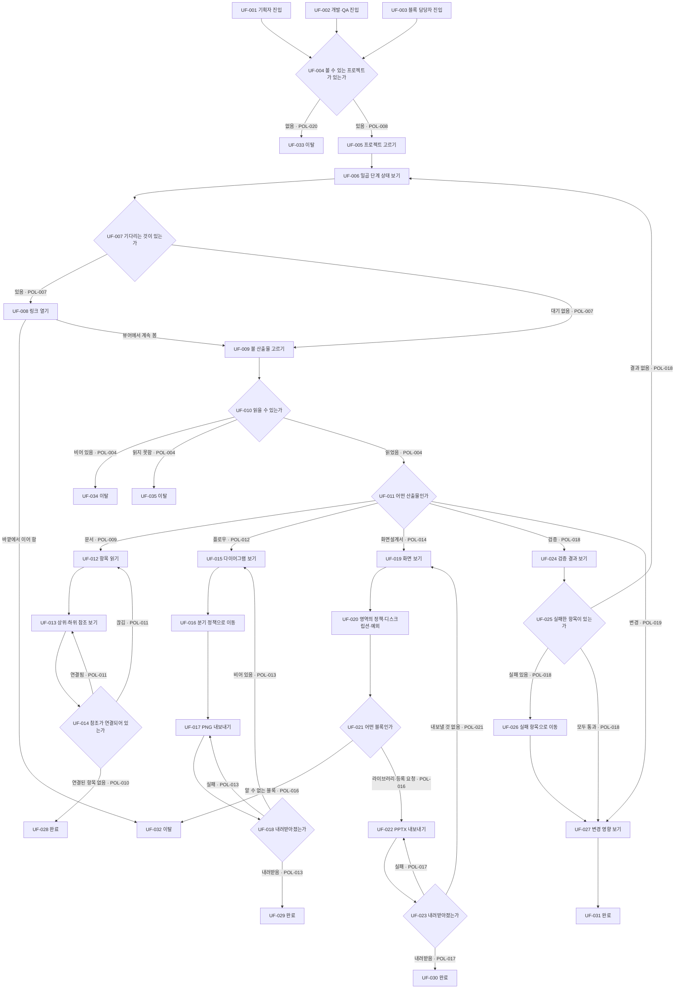

# 유저 플로우: UX AI Studio

> **Flow Agent가 만든 초안입니다. 사람의 승인 전입니다.**
> 승인은 사람이 PR을 병합할 때만 일어납니다(POL-002).

## 1. 문서 개요

이 문서는 뷰어를 쓰는 사람의 행동 흐름을 UF 항목으로 적습니다. 짝이 되는 [워크 플로우](WORKFLOW.md)와
함께 정의했으며, 한쪽을 끝내고 다른 쪽을 쓰지 않았습니다(POL-012, 에이전트 명세 2절).

| 항목 | 내용 |
| --- | --- |
| 상태 | 검토 필요 |
| ID 규칙 | `UF-000`. 1번부터 차례로 붙이고 비는 번호를 두지 않습니다. 한 번 붙인 ID는 바꾸거나 재사용하지 않습니다. |
| 단계 유형 | 진입, 선택, 분기, 완료, 이탈 |
| 분기 조건 | 스스로 정하지 않았습니다. 모든 분기의 갈래에 [정책서](POLICY.md)의 `POL` 하나를 달았습니다. |
| 화면 배정 | `screen`은 모두 비워 두었습니다. IA Agent가 채웁니다. |
| 짝이 되는 문서 | [워크 플로우](WORKFLOW.md). 이탈을 뺀 모든 단계에 대응하는 처리가 있습니다. |
| 처리용 데이터 | [user-flow.json](user-flow.json) |

단계는 35개입니다. 진입 3개, 선택 15개, 분기 9개, 완료 4개, 이탈 4개입니다.

뷰어는 읽기 전용이라 이 플로우에 저장소를 고치는 단계가 없습니다(REQ-015, POL-001). 편집·승인·실행이
필요한 자리는 링크로 바깥에 넘기고, 사용자가 실제로 나가면 이탈(UF-032)로 봅니다.

## 2. 사용자와 진입 경로

사용자 유형은 [프로젝트 정의서](PROJECT.md) 3절을 따릅니다. 셋 다 프로젝트 목록을 거쳐 들어옵니다(POL-008).

| 사용자 | 들어오는 곳 | 주로 도는 길 |
| --- | --- | --- |
| 기획자 | UF-001 뷰어의 프로젝트 목록 | 주 흐름 전체 (UF-004~031) |
| 개발·QA 담당자 | UF-002 승인된 화면설계서를 받으러 | 화면설계서와 PPTX (UF-019~023, UF-030) |
| UI 블록 담당자 | UF-003 블록 사용 현황을 보러 | 영역과 블록 (UF-019~021) |

## 3. 주 흐름

### 3.1 진입과 프로젝트 고르기

| ID | 단계 | 유형 | 행위자 | 하는 일 | 다음 | 참조 |
| --- | --- | --- | --- | --- | --- | --- |
| UF-001 | **기획자가 뷰어에 들어온다** | 진입 | 기획자 | 뷰어를 열면 볼 수 있는 프로젝트 목록이 먼저 보인다. | UF-004 | REQ-001, POL-008, POL-020 |
| UF-002 | **개발·QA 담당자가 산출물을 받으러 들어온다** | 진입 | 개발·QA 담당자 | 승인된 화면설계서를 넘겨받으려고 뷰어를 연다. | UF-004 | REQ-012, POL-005, POL-008 |
| UF-003 | **UI 블록 담당자가 블록 사용 현황을 보러 들어온다** | 진입 | UI 블록 담당자 | 화면이 어떤 블록을 썼고 등록 요청이 무엇인지 확인하려고 뷰어를 연다. | UF-004 | REQ-011, POL-008, POL-016 |
| UF-004 | **볼 수 있는 프로젝트가 있는가** | 분기 | 셋 모두 | 권한과 프로젝트 폴더에 따라 목록을 보일 수 있는지가 갈린다. | 있음 → UF-005 (POL-008) 없음 → UF-033 (POL-020) | REQ-001, REQ-019, POL-008, POL-020 |
| UF-005 | **프로젝트를 골라 진행 현황으로 들어간다** | 선택 | 기획자 | 이름과 현재 진행 상태를 보고 프로젝트 하나를 고른다. | UF-006 | REQ-001, REQ-002, POL-008 |

### 3.2 진행 현황

| ID | 단계 | 유형 | 행위자 | 하는 일 | 다음 | 참조 |
| --- | --- | --- | --- | --- | --- | --- |
| UF-006 | **일곱 단계의 진행 상태를 본다** | 선택 | 기획자 | 정의서·요구사항·정책·플로우·정보 구조도·화면설계서·검증의 상태와 진행 중인 단계를 한 화면에서 읽는다. | UF-007 | REQ-002, POL-005, POL-006 |
| UF-007 | **사람을 기다리는 것이 있는가** | 분기 | 기획자 | 확정 대기·승인 대기·선택 대기가 있는지에 따라 갈린다. | 있음 → UF-008 (POL-007) 대기 없음 → UF-009 (POL-007) | REQ-003, POL-007 |
| UF-008 | **기다리는 자리의 링크를 연다** | 선택 | 기획자 | 고칠 것은 GitHub, 실행·수정 요청은 세션으로 가는 링크를 누른다. 링크는 새 탭에서 열리고 뷰어 화면은 그대로 남는다. | 바깥에서 이어 함 → UF-032 (POL-003) 뷰어에서 계속 봄 → UF-009 (POL-003) | REQ-004, REQ-016, POL-001, POL-002, POL-003 |
| UF-009 | **볼 산출물을 고른다** | 선택 | 기획자 | 진행 현황의 단계에서 읽을 산출물 하나를 고른다. | UF-010 | REQ-005, POL-004, POL-006 |
| UF-010 | **그 산출물을 읽을 수 있는가** | 분기 | 기획자 | 파일이 있는지, 읽히는지에 따라 갈린다. 뷰어는 파일에 없는 값을 만들지 않는다. | 읽었음 → UF-011 (POL-004) 비어 있음 → UF-034 (POL-004) 읽지 못함 → UF-035 (POL-004) | REQ-005, REQ-020, POL-003, POL-004 |
| UF-011 | **어떤 산출물인가** | 분기 | 기획자 | 산출물의 종류에 따라 보는 화면이 갈린다. | 문서 → UF-012 (POL-009) 플로우 → UF-015 (POL-012) 화면설계서 → UF-019 (POL-014) 검증 → UF-024 (POL-018) 변경 → UF-027 (POL-019) | REQ-005, POL-006, POL-009, POL-012, POL-014, POL-018, POL-019 |

### 3.3 문서와 참조

| ID | 단계 | 유형 | 행위자 | 하는 일 | 다음 | 참조 |
| --- | --- | --- | --- | --- | --- | --- |
| UF-012 | **문서를 항목 단위로 읽는다** | 선택 | 기획자 | 항목마다 ID와 본문을 읽고 AI가 만든 것인지 사람이 고친 것인지 구분해 본다. | UF-013 | REQ-005, POL-005, POL-009 |
| UF-013 | **항목의 상위·하위 참조를 본다** | 선택 | 기획자 | 고른 항목이 참조하는 상위 항목과 그 항목을 참조하는 하위 항목을 함께 본다. | UF-014 | REQ-006, POL-010 |
| UF-014 | **고른 참조가 연결되어 있는가** | 분기 | 기획자 | 참조한 ID가 저장소에 있는지에 따라 이동할 수 있는지가 갈린다. | 연결됨 → UF-013 (POL-011) 끊김 → UF-012 (POL-011) 연결된 항목 없음 → UF-028 (POL-010) | REQ-006, REQ-013, POL-010, POL-011 |

### 3.4 플로우와 PNG

| ID | 단계 | 유형 | 행위자 | 하는 일 | 다음 | 참조 |
| --- | --- | --- | --- | --- | --- | --- |
| UF-015 | **플로우 다이어그램을 본다** | 선택 | 기획자 | 유저 플로우와 워크 플로우를 저장소의 JSON 그대로 그린 다이어그램으로 본다. | UF-016 | REQ-007, POL-012 |
| UF-016 | **분기에 걸린 정책으로 옮겨 간다** | 선택 | 기획자 | 분기 연결의 조건과 정책 ID를 보고 정책 ID를 눌러 그 정책 항목으로 간다. | UF-017 | REQ-007, POL-010, POL-012 |
| UF-017 | **유저 플로우 PNG 내보내기를 누른다** | 선택 | 기획자 | 보고 있는 다이어그램을 PNG로 내려받는다. | UF-018 | REQ-008, POL-013, POL-021 |
| UF-018 | **PNG가 내려받아졌는가** | 분기 | 기획자 | 내보내기 결과에 따라 갈린다. | 내려받음 → UF-029 (POL-013) 실패 → UF-017 (POL-013) 비어 있음 → UF-015 (POL-013) | REQ-008, POL-013 |

### 3.5 화면설계서와 PPTX

| ID | 단계 | 유형 | 행위자 | 하는 일 | 다음 | 참조 |
| --- | --- | --- | --- | --- | --- | --- |
| UF-019 | **화면설계서를 동작하는 화면으로 본다** | 선택 | 기획자 | 화면설계서 JSON으로 그린 화면을 눌러 보며 인터랙션을 확인한다. | UF-020 | REQ-009, REQ-017, POL-014 |
| UF-020 | **영역의 정책·디스크립션·예외를 함께 읽는다** | 선택 | 기획자 | 고른 영역에 걸린 정책·디스크립션·예외를 화면과 나란히 읽고 ID를 눌러 그 항목으로 간다. | UF-021 | REQ-010, POL-015 |
| UF-021 | **영역이 쓴 블록이 어떤 것인가** | 분기 | UI 블록 담당자 | 영역이 참조한 블록이 라이브러리의 것인지, 등록 요청 중인지, 알 수 없는 것인지에 따라 갈린다. | 라이브러리 블록 → UF-022 (POL-016) 등록 요청 중 → UF-022 (POL-016) 알 수 없는 블록 → UF-032 (POL-016) | REQ-011, REQ-018, POL-016 |
| UF-022 | **화면설계서 PPTX 내보내기를 누른다** | 선택 | 기획자 | 화면설계서를 PPTX로 내보내 개발·QA에 넘긴다. | UF-023 | REQ-012, POL-017, POL-021 |
| UF-023 | **PPTX가 내려받아졌는가** | 분기 | 기획자 | 내보내기 결과에 따라 갈린다. | 내려받음 → UF-030 (POL-017) 실패 → UF-022 (POL-017) 내보낼 것 없음 → UF-019 (POL-021) | REQ-012, POL-017, POL-021 |

### 3.6 검증과 변경

| ID | 단계 | 유형 | 행위자 | 하는 일 | 다음 | 참조 |
| --- | --- | --- | --- | --- | --- | --- |
| UF-024 | **검증 결과 목록을 본다** | 선택 | 기획자 | 규칙마다 통과와 실패를, 실패한 항목의 ID를 목록으로 본다. | UF-025 | REQ-013, POL-018 |
| UF-025 | **실패한 항목이 있는가** | 분기 | 기획자 | 검증 결과에 따라 다음에 볼 것이 갈린다. | 실패 있음 → UF-026 (POL-018) 모두 통과 → UF-027 (POL-018) 결과 없음 → UF-006 (POL-018) | REQ-013, POL-018 |
| UF-026 | **실패 항목으로 옮겨 간다** | 선택 | 기획자 | 실패 항목을 눌러 해당 문서 항목이나 화면으로 간다. 끊긴 참조는 누를 수 없다. | UF-027 | REQ-013, POL-011, POL-018 |
| UF-027 | **변경 영향 목록에서 판정을 본다** | 선택 | 기획자 | 무엇이 바뀌었고 그 때문에 어디가 수정 필요·검토 필요인지 목록으로 본다. | UF-031 | REQ-014, POL-019 |

## 4. 완료

| ID | 단계 | 유형 | 행위자 | 어디서 끝나는가 | 참조 |
| --- | --- | --- | --- | --- | --- |
| UF-028 | **참조 확인을 마친다** | 완료 | 기획자 | 항목과 그 상위·하위 참조를 다 따라가 보고 문서 사이의 연결을 확인한 상태로 끝난다. | REQ-005, REQ-006, POL-009, POL-010 |
| UF-029 | **PNG를 받아 다른 도구에서 쓴다** | 완료 | 기획자 | 내려받은 유저 플로우 PNG를 뷰어 밖의 문서나 발표 자료에 쓴다. | REQ-008, POL-013, POL-021 |
| UF-030 | **PPTX를 받아 개발·QA에 넘긴다** | 완료 | 개발·QA 담당자 | 내려받은 화면설계서 PPTX를 개발과 테스트에 쓴다. | REQ-012, POL-017 |
| UF-031 | **고쳐야 할 곳을 추려 낸다** | 완료 | 기획자 | 검증 실패와 변경 영향에서 고칠 항목을 추려, 세션이나 GitHub에서 할 일을 정한 상태로 끝난다. | REQ-013, REQ-014, POL-018, POL-019 |

## 5. 이탈

완료만 있는 플로우는 완료로 보지 않습니다(에이전트 명세 5절). 뷰어에서 사용자가 떠나는 자리는 넷입니다.

| ID | 단계 | 유형 | 언제 | 그 뒤 | 참조 |
| --- | --- | --- | --- | --- | --- |
| UF-032 | **뷰어 밖에서 고치거나 승인한다** | 이탈 | 편집·승인·실행이 필요하거나 알 수 없는 블록을 알려야 할 때 링크를 따라 나간다. | 일은 세션과 GitHub에서 이어집니다. 뷰어는 새로고침으로 바뀐 내용을 다시 읽습니다(POL-004, 제안). | REQ-004, REQ-015, REQ-016, POL-001, POL-002, POL-003 |
| UF-033 | **볼 수 있는 프로젝트가 없어 떠난다** | 이탈 | 저장소를 읽을 권한이 없거나 프로젝트가 하나도 없다. | '볼 수 있는 프로젝트가 없습니다'만 보이고 다른 화면으로 가지 않습니다. | REQ-001, REQ-019, POL-008, POL-020 |
| UF-034 | **아직 만들어지지 않은 단계라 보기를 멈춘다** | 이탈 | 고른 단계의 파일이 아직 없다. | '비어 있음'과 '아직 만들어지지 않았습니다'를 보이고 그 산출물 보기를 멈춥니다. | REQ-005, REQ-020, POL-003, POL-004 |
| UF-035 | **파일을 읽지 못해 보기를 멈춘다** | 이탈 | 파일을 읽지 못했거나 JSON이 깨져 있다. | 경로와 함께 '읽지 못했습니다'를 보이고 화면의 나머지는 그대로 남습니다. | REQ-020, POL-004 |

## 6. 분기와 연결된 정책

분기 9개의 갈래마다 근거 정책을 달았습니다. 정책에 없는 분기는 만들지 않았습니다(QA-03).

| 분기 | 갈래와 근거 정책 |
| --- | --- |
| UF-004 볼 수 있는 프로젝트가 있는가 | 있음 POL-008 · 없음 POL-020 |
| UF-007 사람을 기다리는 것이 있는가 | 대기 있음 POL-007 · 대기 없음 POL-007 |
| UF-010 그 산출물을 읽을 수 있는가 | 읽었음·비어 있음·읽지 못함 모두 POL-004 |
| UF-011 어떤 산출물인가 | 문서 POL-009 · 플로우 POL-012 · 화면설계서 POL-014 · 검증 POL-018 · 변경 POL-019 |
| UF-014 고른 참조가 연결되어 있는가 | 연결됨·끊김 POL-011 · 연결된 항목 없음 POL-010 |
| UF-018 PNG가 내려받아졌는가 | 내려받음·실패·비어 있음 모두 POL-013 |
| UF-021 영역이 쓴 블록이 어떤 것인가 | 라이브러리·등록 요청 중·알 수 없음 모두 POL-016 |
| UF-023 PPTX가 내려받아졌는가 | 내려받음·실패 POL-017 · 내보낼 것 없음 POL-021 |
| UF-025 실패한 항목이 있는가 | 실패 있음·모두 통과·결과 없음 모두 POL-018 |

## 7. 워크 플로우와의 대응

이탈을 뺀 31개 단계마다 대응하는 시스템 처리가 있습니다(POL-012, QA-03). 이탈 네 개에도 화면에
무엇을 보일지를 정한 처리를 달았습니다.

| 유저 플로우 | 워크 플로우 | 유저 플로우 | 워크 플로우 |
| --- | --- | --- | --- |
| UF-001 | WF-001 | UF-019 | WF-019 |
| UF-002 | WF-002 | UF-020 | WF-020 |
| UF-003 | WF-003 | UF-021 | WF-021 |
| UF-004 | WF-004 | UF-022 | WF-022 |
| UF-005 | WF-005 | UF-023 | WF-023 |
| UF-006 | WF-006 | UF-024 | WF-024 |
| UF-007 | WF-007 | UF-025 | WF-025 |
| UF-008 | WF-008 | UF-026 | WF-026 |
| UF-009 | WF-009 | UF-027 | WF-027 |
| UF-010 | WF-010 | UF-028 | WF-028 |
| UF-011 | WF-011 | UF-029 | WF-029 |
| UF-012 | WF-012 | UF-030 | WF-030 |
| UF-013 | WF-013 | UF-031 | WF-031 |
| UF-014 | WF-014 | UF-032 | WF-032 |
| UF-015 | WF-015 | UF-033 | WF-033 |
| UF-016 | WF-016 | UF-034 | WF-034 |
| UF-017 | WF-017 | UF-035 | WF-035 |
| UF-018 | WF-018 | | |

## 8. 화면 배정

모든 단계의 `screen`은 `null`입니다. Flow Agent는 화면을 정하지 않습니다. IA Agent가
정보 구조도(`IA.md`)를 만들면서 진입·선택·완료 단계에 화면을 배정합니다.

## 9. 총괄 에이전트에 넘기는 사항

정책에 없어 분기로 만들지 않은 것들입니다. **제안**으로만 적습니다.

| 사항 | 지금 어떻게 두었는가 | 왜 확정이 필요한가 |
| --- | --- | --- |
| 저장소를 다시 읽는 시점 | UF-032에서 나갔다 돌아오면 새로고침으로 다시 읽는 것으로 적었습니다(POL-004의 제안) | 실시간이면 되돌아오는 단계가 하나 더 필요합니다 |
| 사용자 유형별 첫 화면 | UF-001~003을 모두 프로젝트 목록(UF-004)으로 모았습니다 | 담당자마다 첫 화면이 다르면 진입 단계의 다음이 갈립니다 |
| 내보내기를 거듭 실패할 때 | UF-018·UF-023에서 다시 시도로만 돌려보냈습니다(POL-013, POL-017) | 몇 번 뒤에 포기하는지가 정책에 없어 이탈 단계를 만들지 않았습니다 |
| 알 수 없는 블록을 알리는 자리 | UF-021에서 세션으로 나가는 이탈(UF-032)로 두었습니다 | 블록 레지스트리로 가는 자리가 정책에 없습니다 |

## 변경 이력

| 버전 | 날짜 | 변경 내용 |
| --- | --- | --- |
| 0.1.0 | 2026-11-26 | 최초 작성. 요구사항 21개와 정책 21개에서 단계 35개(진입 3, 선택 15, 분기 9, 완료 4, 이탈 4)를 뽑았습니다. 워크 플로우 0.1.0과 함께 정의했습니다. Flow Agent의 초안이며 사람의 승인 전입니다. |
