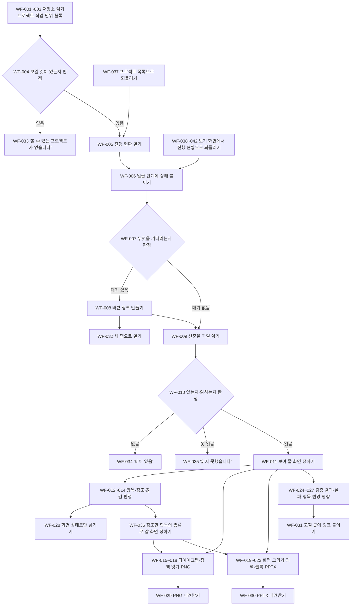

# 워크 플로우: UX AI Studio

> **Flow Agent가 만든 초안입니다. 사람의 승인 전입니다.**
> 승인은 사람이 PR을 병합할 때만 일어납니다(POL-002).

## 1. 문서 개요

이 문서는 [유저 플로우](USER-FLOW.md)의 단계마다 뷰어가 하는 처리를 WF 항목으로 적습니다.
두 문서는 한쪽을 끝내고 다른 쪽을 쓰지 않고 서로 참조하며 함께 정의했습니다(POL-012).

| 항목 | 내용 |
| --- | --- |
| 상태 | 검토 필요 |
| ID 규칙 | `WF-000`. 1번부터 차례로 붙이고 비는 번호를 두지 않습니다. 한 번 붙인 ID는 바꾸거나 재사용하지 않습니다. |
| 처리 유형 | 처리, 검증, 상태 변경, 연동 |
| 짝이 되는 문서 | [유저 플로우](USER-FLOW.md). 처리마다 대응하는 `user_step`이 하나 있습니다. |
| 처리용 데이터 | [workflow.json](workflow.json) |

처리는 42개입니다. 처리 16개, 검증 7개, 상태 변경 13개, 연동 6개입니다. 유저 플로우의 42개 단계에
하나씩 대응하며, 이탈 네 단계에도 화면에 무엇을 보일지를 정한 처리를 달았습니다.

0.2.0에서 여섯(WF-036~041)을 더했습니다. [검증 보고서](QA-REPORT.md) 5절의 QA-03이 짚은
'화면에는 있는데 플로우에 없는 길' 여섯에 대응하는 처리이며, [유저 플로우](USER-FLOW.md) 0.3.0의
UF-036~041과 하나씩 짝입니다. 여섯 모두 보는 화면을 바꾸는 일이라 유형이 **상태 변경**입니다.
저장소를 바꾸는 처리는 이번에도 하나도 없습니다.

0.3.0에서 하나(WF-042)를 더했습니다. 재검증(QA 0.2.0)이 SCR-006의 머리 뒤로가기에도 대응 단계가
없다고 짚어 유저 플로우가 UF-042를 세웠고, 그 짝입니다. 이것도 상태 변경입니다.

### 이 워크 플로우가 바꾸지 않는 것

뷰어는 저장소를 읽기만 합니다(REQ-015, POL-001). 그래서 이 문서의 `state_change`는 모두
**화면 상태(React State)**이고, 저장소의 파일이나 문서 상태를 바꾸는 처리는 하나도 없습니다.
문서 상태를 바꾸는 일(생성, 검토, 승인)은 세션과 GitHub에서 일어나며 이 문서의 범위 밖입니다.

ERD가 없으므로 `input`과 `output`은 파일 경로와 화면이 쓰는 덩어리 이름으로 적었습니다
(데이터 규격 1절, 정책서 1절).

## 2. 흐름 한눈에 보기

## 3. 읽기와 프로젝트 목록

| ID | 처리 | 유형 | 읽는 것 → 쓰는 것 | 상태 변경 | 대응 단계 | 참조 |
| --- | --- | --- | --- | --- | --- | --- |
| WF-001 | **프로젝트 폴더를 읽어 목록을 만든다** 폴더마다 정의서와 상태 파일을 읽어 이름과 현재 진행 상태를 붙인다. 진행 상태는 아직 끝나지 않은 가장 앞선 단계로 삼는다. | 처리 | `projects/`, `project.json`, `_meta/status.json` → 프로젝트 카드 목록 | 없음 | UF-001 | REQ-001, POL-004, POL-008 |
| WF-002 | **승인된 화면설계서가 있는 프로젝트를 표시한다** 상태 파일의 SB 줄과 작업 단위 상태로 넘겨받을 수 있는 것을 구분한다. | 처리 | `_meta/status.json`의 SB 줄과 `work_units` → 작업 단위 상태가 붙은 목록 | 없음 | UF-002 | REQ-012, POL-005, POL-008 |
| WF-003 | **화면 파일에서 쓰인 블록을 모은다** 영역마다 적힌 블록 ID와 Major 버전 범위를 모은다. 블록의 사본은 읽지 않는다. | 처리 | `screens/SCR-000.json` → 블록 ID와 버전 범위 목록 | 없음 | UF-003 | REQ-011, REQ-018, POL-016 |
| WF-004 | **보일 프로젝트가 있는지 판정한다** 접근 권한과 목록 결과로 판정한다. | 검증 | 저장소 접근 권한, 프로젝트 카드 목록 → 목록 또는 안내 문구 | 없음 | UF-004 | REQ-001, REQ-019, POL-008, POL-020 |
| WF-005 | **고른 프로젝트의 진행 현황을 연다** 상태 파일을 읽어 화면 데이터를 만들고 보는 화면을 바꾼다. 저장소에는 아무것도 쓰지 않는다. | 상태 변경 | `_meta/status.json` → 진행 현황 화면 데이터 | 보는 화면: 프로젝트 목록 → 진행 현황 | UF-005 | REQ-001, REQ-015, POL-008, POL-014 |

## 4. 진행 현황과 산출물 고르기

| ID | 처리 | 유형 | 읽는 것 → 쓰는 것 | 상태 변경 | 대응 단계 | 참조 |
| --- | --- | --- | --- | --- | --- | --- |
| WF-006 | **일곱 단계에 상태를 하나씩 붙인다** 플로우는 두 문서 중 뒤처진 쪽을 단계 상태로 삼는다. 상태 줄이 없으면 '대기', 다섯 값에 없는 값은 '알 수 없음'이다. | 처리 | `_meta/status.json`, `project.json`의 `confirmed` → 일곱 단계와 상태, 진행 중인 단계 | 없음 | UF-006 | REQ-002, POL-005, POL-006 |
| WF-007 | **무엇을 기다리는지 판정한다** 확정 대기·승인 대기·선택 대기를 판정하고, 둘 이상이면 앞선 단계의 것을 먼저 보인다. | 검증 | 단계별 상태, `confirmed`, `work_units` → 네 값 중 하나와 기다리는 것의 목록 | 없음 | UF-007 | REQ-003, POL-007 |
| WF-008 | **바깥으로 가는 링크 주소를 만든다** 고칠 자리는 GitHub, 실행·수정 요청 자리는 세션으로 간다. 주소를 만들지 못하면 비활성으로 둔다. | 연동 | `status.json`의 `pr`, 파일 경로 → GitHub·세션 링크, 비활성 링크 | 없음 | UF-008 | REQ-004, REQ-016, POL-001, POL-002, POL-003 |
| WF-009 | **고른 단계의 산출물 파일을 읽는다** Markdown과 JSON을 읽어 원본과 읽은 시각을 함께 둔다. | 처리 | `<문서>.md`, `<문서>.json` → 문서 원본, 읽은 시각 | 없음 | UF-009 | REQ-005, REQ-020, POL-004, POL-006 |
| WF-010 | **파일이 있는지와 읽히는지 판정한다** 없으면 '비어 있음', 읽지 못하거나 깨져 있으면 '읽지 못함'이다. | 검증 | 파일 경로, 읽은 JSON → 읽음·비어 있음·읽지 못함 | 없음 | UF-010 | REQ-020, POL-003, POL-004 |
| WF-011 | **문서 코드로 보여 줄 화면을 정한다** `doc` 값으로 항목 목록·다이어그램·화면설계서·검증·변경 중 하나를 고른다. | 상태 변경 | 읽은 JSON의 `doc` → 보기 화면 종류 | 보는 화면: 진행 현황 → 고른 산출물의 보기 화면 | UF-011 | REQ-005, POL-006, POL-014 |

### 4.1 화면을 되돌리는 처리 (0.2.0에서 더함)

화면 머리의 뒤로가기를 받는 처리 여섯입니다(WF-042는 0.3.0에서 더했습니다). 여섯 모두 **보는
화면만 바꾸고 저장소는 읽기만 합니다.** 떠나는 화면의 화면 상태를 버리는 것이 처리마다 다르기 때문에 하나로 묶지 않았습니다.
까닭은 [유저 플로우](USER-FLOW.md) 3.7절에 적었습니다.

| ID | 처리 | 유형 | 읽는 것 → 쓰는 것 | 상태 변경 | 대응 단계 | 참조 |
| --- | --- | --- | --- | --- | --- | --- |
| WF-037 | **프로젝트 목록으로 되돌리고 고른 프로젝트를 비운다** 이미 만들어 둔 카드 목록을 그대로 쓰고, 들고 있지 않으면 WF-001을 다시 돌린다. | 상태 변경 | 프로젝트 카드 목록, `projects/`, `project.json` → 프로젝트 목록 화면 데이터 | 보는 화면: 진행 현황 → 프로젝트 목록 | UF-037 | REQ-001, REQ-015, POL-008, POL-014 |
| WF-038 | **문서 보기에서 진행 현황으로 되돌리고 참조 자취를 버린다** WF-028이 화면 상태로만 들고 있던 `visitedTrail`과 고른 항목을 버린다. | 상태 변경 | `_meta/status.json`, 진행 현황 화면 데이터 → 진행 현황 화면 데이터 | 보는 화면: 문서 보기 → 진행 현황 | UF-038 | REQ-002, REQ-005, REQ-015, POL-006, POL-014 |
| WF-039 | **플로우 미리보기에서 되돌리고 다이어그램 상태를 버린다** 고른 단계, 접힘, 확대를 버린다. 만든 PNG는 이미 내려받기로 넘겼으므로 들고 있지 않는다. | 상태 변경 | `_meta/status.json`, 진행 현황 화면 데이터 → 진행 현황 화면 데이터 | 보는 화면: 플로우 미리보기 → 진행 현황 | UF-039 | REQ-002, REQ-007, REQ-015, POL-006, POL-014 |
| WF-040 | **화면설계서 뷰어에서 되돌리고 화면 state를 버린다** 고른 영역과 인터랙션으로 바뀐 값을 버린다. 누른 결과는 저장소에 남지 않는다(POL-014). | 상태 변경 | `_meta/status.json`, 진행 현황 화면 데이터 → 진행 현황 화면 데이터 | 보는 화면: 화면설계서 뷰어 → 진행 현황 | UF-040 | REQ-002, REQ-009, REQ-017, REQ-015, POL-006, POL-014 |
| WF-041 | **변경 영향에서 되돌리고 고른 변경 줄을 버린다** 검증 결과에서 들어왔어도 되돌아가는 곳은 진행 현황 하나다. | 상태 변경 | `_meta/status.json`, 진행 현황 화면 데이터 → 진행 현황 화면 데이터 | 보는 화면: 변경 영향 → 진행 현황 | UF-041 | REQ-002, REQ-014, REQ-015, POL-006, POL-014 |
| WF-042 | **검증 결과에서 되돌리고 고른 규칙을 버린다** 고른 규칙과 그 규칙의 실패 항목 표시를 버린다. 읽은 시점은 화면마다 따로 들고 있으므로 진행 현황의 것으로 돌아간다. 검증을 다시 돌리지 않는다. | 상태 변경 | `_meta/status.json`, 진행 현황 화면 데이터 → 진행 현황 화면 데이터 | 보는 화면: 검증 결과 → 진행 현황 | UF-042 | REQ-002, REQ-013, REQ-015, POL-006, POL-014 |

WF-042는 **WF-025(검증 결과와 실패 항목이 있는지 판정한다)와 다릅니다.** WF-025는 검증 파일이
없을 때 뷰어가 내리는 판정이고, WF-042는 결과가 있든 없든 사용자가 머리를 눌러 떠날 때 돌아가는
처리입니다. 버리는 것도 WF-042에만 있습니다.

진행 현황 화면 데이터는 WF-006이 만든 것을 다시 쓰되, 들고 있지 않으면 `_meta/status.json`을
다시 읽어 만듭니다. 읽은 시점을 언제로 보일지는 POL-004의 제안에 걸려 있어 11절에 그대로 둡니다.

## 5. 문서와 참조

| ID | 처리 | 유형 | 읽는 것 → 쓰는 것 | 상태 변경 | 대응 단계 | 참조 |
| --- | --- | --- | --- | --- | --- | --- |
| WF-012 | **항목 목록을 만들고 출처를 구분한다** `items`를 파일 순서 그대로 쓰고 `origin`으로 AI 생성과 사람 수정을 구분한다. | 처리 | `<문서>.json`의 `items` → 항목 목록(ID, 본문, 출처) | 없음 | UF-012 | REQ-005, POL-005, POL-009 |
| WF-013 | **상위 항목과 하위 항목을 모은다** `refs`로 상위를, 역참조 색인으로 하위를 모은다. | 처리 | 항목의 `refs`, 전체 문서의 역색인 → 상위·하위 항목 목록 | 없음 | UF-013 | REQ-006, POL-010 |
| WF-014 | **참조가 연결되어 있는지 판정한다** 저장소에서 찾지 못한 ID는 끊김으로 보고 누를 수 없게 둔다. | 검증 | 참조한 ID 목록, 전체 항목 ID → 연결됨·끊김 | 없음 | UF-014 | REQ-006, REQ-013, POL-010, POL-011 |
| WF-028 | **따라간 참조 경로를 화면 상태로만 남긴다** 옮겨 간 자취는 화면을 떠나면 버린다. 저장소에는 쓰지 않는다. | 상태 변경 | 옮겨 간 항목 ID → 화면 안의 이동 자취 | 따라간 항목 경로: 이전 항목 → 지금 보는 항목 | UF-028 | REQ-005, REQ-006, REQ-015, POL-010, POL-014 |
| WF-036 | **참조한 항목의 종류로 옮겨 갈 보기 화면을 정한다** ID 앞자리가 UF·WF면 플로우 미리보기를, SCR이면 화면설계서 뷰어를 열고 그 항목을 고른 상태로 둔다. 어느 쪽도 아니면 같은 화면 안에서 항목만 옮긴다(WF-028). | 상태 변경 | 고른 참조 항목의 ID와 문서 코드, `user-flow.json`, `workflow.json`, `screens/SCR-000.json` → 옮겨 갈 보기 화면, 고른 상태로 둘 항목 | 보는 화면: 문서 보기 → 플로우 미리보기 또는 화면설계서 뷰어 | UF-036 | REQ-005, REQ-006, POL-010, POL-012, POL-014 |

WF-036은 WF-011(문서 코드로 보여 줄 화면을 정한다)과 하는 일이 닮았지만 **들어오는 자리가
다릅니다.** WF-011은 진행 현황에서 단계를 골라 들어오는 길이고, WF-036은 문서 보기의 참조 패널에서
다른 산출물의 항목을 눌러 들어오는 길입니다. 옮겨 간 뒤 그 항목을 고른 상태로 두는 것도 WF-036만
합니다. 그래서 WF-011에 갈래를 더하지 않고 처리를 따로 세웠습니다.

## 6. 플로우와 PNG

| ID | 처리 | 유형 | 읽는 것 → 쓰는 것 | 상태 변경 | 대응 단계 | 참조 |
| --- | --- | --- | --- | --- | --- | --- |
| WF-015 | **플로우 JSON으로 다이어그램 모델을 만든다** 단계와 연결을 JSON 그대로 노드와 선으로 옮긴다. 단계가 없으면 '비어 있음'이다. | 처리 | `user-flow.json`, `workflow.json` → 노드와 연결선, 분기 조건 | 없음 | UF-015 | REQ-007, POL-012 |
| WF-016 | **분기의 정책을 정책 항목에 잇는다** `next.policy`를 정책에 이어 ID를 보이고, 없는 연결은 '정책 없음'으로 구분한다. | 상태 변경 | `user-flow.json`의 `next.policy`, `policies.json` → 정책 ID 표시 | 보는 항목: 플로우 다이어그램 → 정책 항목 | UF-016 | REQ-007, POL-010, POL-012 |
| WF-017 | **보고 있는 다이어그램을 PNG로 만든다** 접거나 숨긴 부분도 보이던 모양 그대로 담는다. | 처리 | 화면에 그려진 다이어그램 → PNG 파일 | 없음 | UF-017 | REQ-008, POL-013, POL-021 |
| WF-018 | **PNG 내보내기 결과를 판정한다** 실패하면 다시 시도할 수 있게 두고, 비어 있으면 누를 수 없게 둔다. | 검증 | PNG 파일, 다이어그램 노드 수 → 내려받음·내보내지 못함·내보낼 것 없음 | 없음 | UF-018 | REQ-008, POL-013, POL-021 |
| WF-029 | **만든 PNG를 내려받기로 넘긴다** 저장소에 파일을 남기지 않는다. | 연동 | PNG 파일 → 내려받은 PNG | 없음 | UF-029 | REQ-008, REQ-015, POL-013, POL-021 |

## 7. 화면설계서와 PPTX

| ID | 처리 | 유형 | 읽는 것 → 쓰는 것 | 상태 변경 | 대응 단계 | 참조 |
| --- | --- | --- | --- | --- | --- | --- |
| WF-019 | **화면 파일의 영역을 React 블록으로 그린다** `state` 초기값으로 인터랙션을 준비한다. 그리지 못한 영역에는 블록 ID와 안내를 보이고 나머지는 그대로 그린다. | 처리 | `screens/SCR-000.json`, UI 블록 컴포넌트 → 그려진 화면, 영역 목록, 화면 state | 없음 | UF-019 | REQ-009, REQ-017, POL-014 |
| WF-020 | **고른 영역의 정책·디스크립션·예외를 꺼낸다** 비어 있으면 '걸린 정책이 없습니다', '적힌 예외가 없습니다'를 보인다. | 상태 변경 | 영역의 `policies`·`description`·`exceptions`, `policies.json`, `requirements.json` → 영역 패널 | 고른 영역: 고르지 않음 → 고른 영역 ID | UF-020 | REQ-010, POL-014, POL-015 |
| WF-021 | **블록 ID를 라이브러리와 등록 요청에 맞춰 본다** 어디에도 없으면 '알 수 없는 블록'으로 구분한다. | 연동 | 영역의 `block.id`·`block.version`, 블록 레지스트리, BRQ 목록 → 세 값 중 하나와 요청 번호 | 없음 | UF-021 | REQ-011, REQ-018, POL-016 |
| WF-022 | **화면과 디스크립션을 PPTX로 만든다** 화면 한 장에 장표 한 장으로 담고(POL-017, 제안), 그리지 못한 영역도 표시해 담는다. | 처리 | 그려진 화면, 영역별 디스크립션 → PPTX 파일 | 없음 | UF-022 | REQ-012, POL-017, POL-021 |
| WF-023 | **PPTX 내보내기 결과를 판정한다** 실패하면 다시 시도할 수 있게 두고, 내보낼 것이 없으면 내보내기를 보이지 않는다. | 검증 | PPTX 파일, 화면 수 → 내려받음·내보내지 못함·내보낼 것 없음 | 없음 | UF-023 | REQ-012, POL-017, POL-021 |
| WF-030 | **만든 PPTX를 내려받기로 넘긴다** 저장소에 파일을 남기지 않는다. | 연동 | PPTX 파일 → 내려받은 PPTX | 없음 | UF-030 | REQ-012, REQ-015, POL-017, POL-021 |

## 8. 검증과 변경

| ID | 처리 | 유형 | 읽는 것 → 쓰는 것 | 상태 변경 | 대응 단계 | 참조 |
| --- | --- | --- | --- | --- | --- | --- |
| WF-024 | **검증 파일을 읽어 규칙별 결과를 만든다** 뷰어가 다시 판정하지 않는다. | 처리 | `validation.json` → 규칙별 통과·실패, 실패 항목 ID, 요구사항 반영률 | 없음 | UF-024 | REQ-013, REQ-020, POL-018 |
| WF-025 | **검증 결과와 실패 항목이 있는지 판정한다** 파일이 없으면 '검증 결과가 없습니다'이다. | 검증 | 규칙별 통과·실패 → 실패 있음·모두 통과·결과 없음 | 없음 | UF-025 | REQ-013, POL-018 |
| WF-026 | **실패 항목을 해당 항목이나 화면에 잇는다** 저장소에 없는 ID는 끊긴 참조로 보이고 이동하지 않는다. | 상태 변경 | `validation.json`의 `targets`, 전체 항목 ID → 이동할 항목 또는 끊긴 참조 | 보는 항목: 검증 결과 목록 → 실패 항목의 문서 항목 또는 화면 | UF-026 | REQ-013, POL-011, POL-018 |
| WF-027 | **변경과 영향·판정을 목록으로 만든다** 판정은 '수정 필요'와 '검토 필요' 둘이며 뷰어가 다시 판정하지 않는다. | 처리 | `_meta/changes.json` → 변경 목록, 영향받는 산출물과 판정 | 없음 | UF-027 | REQ-014, REQ-020, POL-019 |
| WF-031 | **고칠 곳 목록에 바깥으로 가는 링크를 붙인다** 고치는 일은 뷰어 밖에서 한다. | 연동 | 실패 항목, 영향받는 항목과 판정 → 고칠 곳 목록, GitHub·세션 링크 | 없음 | UF-031 | REQ-013, REQ-014, POL-003, POL-018, POL-019 |

## 9. 이탈 자리의 처리

사용자가 떠나는 자리에서도 화면에 무엇을 보일지는 정해져 있습니다(POL-004, POL-008, POL-020).

| ID | 처리 | 유형 | 읽는 것 → 쓰는 것 | 대응 단계 | 참조 |
| --- | --- | --- | --- | --- | --- |
| WF-032 | **링크를 새 탭으로 열고 화면을 그대로 둔다** 주소를 만들지 못한 링크는 비활성으로 둔다. | 연동 | 링크 주소 → 새 탭, 그대로 남은 뷰어 화면 | UF-032 | REQ-004, REQ-015, POL-001, POL-003 |
| WF-033 | **볼 수 있는 프로젝트가 없다고 보인다** 권한이 없으면 '볼 수 있는 프로젝트가 없습니다'이다. | 처리 | 빈 목록, 접근 권한 → 안내 문구 | UF-033 | REQ-001, REQ-019, POL-008, POL-020 |
| WF-034 | **아직 만들어지지 않았다고 보인다** 임의의 값을 채우지 않는다. | 처리 | 없는 파일 경로 → '비어 있음', 비활성 GitHub 링크 | UF-034 | REQ-005, REQ-020, POL-003, POL-004 |
| WF-035 | **읽지 못했다고 보이고 나머지는 그대로 그린다** JSON이 깨졌으면 항목 목록 자리에만 '읽을 수 없습니다'를 보인다. | 처리 | 읽지 못한 경로, 깨진 JSON → 안내 문구와 경로, 나머지 화면 | UF-035 | REQ-020, POL-004 |

## 10. 유저 플로우와의 대응

처리마다 `user_step`이 하나씩 있고, 유저 플로우의 42개 단계가 모두 덮입니다(QA-03).
대응이 없는 단계 0건, 가리키는 단계가 없는 처리 0건, 한 단계를 둘이 가리키는 처리 0건입니다.
대응표는 [유저 플로우](USER-FLOW.md) 7절에 있습니다.

| 유형 | 개수 | 어떤 처리인가 |
| --- | --- | --- |
| 처리 | 16 | 저장소 파일을 읽어 화면이 쓸 모양으로 만드는 것 |
| 검증 | 7 | 보일 수 있는지, 읽히는지, 내보내졌는지를 판정하는 것 |
| 상태 변경 | 13 | 화면 상태(React State)만 바꾸는 것. 저장소는 바꾸지 않는다 |
| 연동 | 6 | 바깥으로 링크를 보내거나 파일을 내려받기로 넘기는 것 |

0.2.0에서 늘어난 여섯과 0.3.0에서 늘어난 하나는 모두 상태 변경입니다(6 → 13). 되돌아가기는
**보는 화면을 바꾸는 일**이고 그 밖에 하는 일이 없기 때문입니다. 저장소에 쓰는 처리는 여전히
0개입니다.

## 11. 총괄 에이전트에 넘기는 사항

정책에 없어 처리로 정하지 못한 것들입니다. **제안**으로만 적습니다.

| 사항 | 지금 어떻게 두었는가 | 왜 확정이 필요한가 |
| --- | --- | --- |
| 저장소를 다시 읽는 방식 | WF-009에서 읽은 시각을 함께 두고, 다시 읽기는 새로고침으로 두었습니다(POL-004의 제안) | 실시간이면 읽는 처리와 상태 표시가 달라집니다 |
| 역참조 색인을 만드는 범위 | WF-013에서 '저장소 전체 문서'로 두었습니다 | 프로젝트 하나인지 여러 개인지가 정책에 없습니다 |
| 블록 레지스트리를 읽는 경로 | WF-021에서 '블록 레지스트리'와 'BRQ 목록'으로만 적었습니다 | 레지스트리가 아직 목업이라 읽을 경로가 정해지지 않았습니다 |
| PPTX 장표 단위 | WF-022에서 화면 한 장에 장표 한 장으로 두었습니다(POL-017의 제안) | 작업 단위나 영역 단위로 나누면 처리가 달라집니다 |
| 되돌아갈 때 다시 읽는지 | WF-038~042에서 WF-006이 만든 진행 현황 데이터를 다시 쓰고, 없으면 `status.json`을 다시 읽는 것으로 두었습니다 | POL-004의 '읽은 시점' 조건이 제안인 채라, 되돌아간 화면이 언제 읽은 값을 보이는지가 정해지지 않았습니다 |
| 떠난 화면의 상태를 언제 버리는지 | WF-038~042에서 화면을 떠나는 그때 버리는 것으로 두었습니다 | 뒤로 갔다 다시 들어왔을 때 보던 자리를 되살릴지가 정책에도 플로우에도 없습니다 |

## 변경 이력

| 버전 | 날짜 | 변경 내용 |
| --- | --- | --- |
| 0.3.0 | 2026-11-27 | 재검증(QA 0.2.0)의 QA-03이 남긴 하나를 받아 WF-042(검증 결과에서 되돌리고 고른 규칙을 버린다)를 더했습니다. 유저 플로우 0.4.0의 UF-042와 짝입니다. 처리 41 → 42이고 상태 변경이 12 → 13으로 늘었습니다. WF-001~041은 고치지 않았습니다. |
| 0.2.0 | 2026-11-27 | QA-03 플로우 연결 실패 1~6번을 받아 처리 여섯(WF-036~041)을 더했습니다. WF-036은 참조한 항목의 종류로 갈 화면을 정하는 처리이고, WF-037~041은 화면을 되돌리는 처리입니다(4.1절). 처리 35 → 41이 되었고 유형은 상태 변경이 6 → 12로 늘었습니다. 유저 플로우 0.3.0의 41개 단계와 하나씩 대응합니다. |
| 0.1.0 | 2026-11-26 | 최초 작성. 유저 플로우 0.1.0의 단계 35개에 대응하는 처리 35개(처리 16, 검증 7, 상태 변경 6, 연동 6)를 적었습니다. 유저 플로우와 함께 정의했습니다. Flow Agent의 초안이며 사람의 승인 전입니다. |
